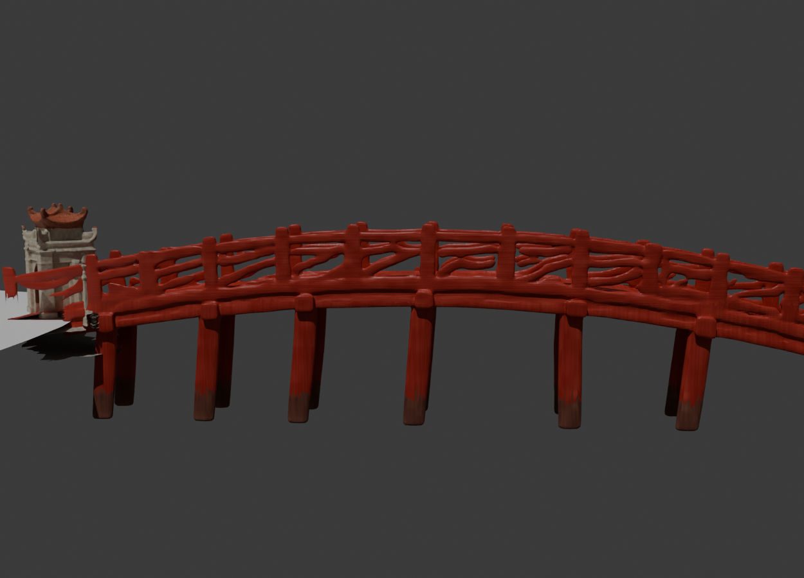
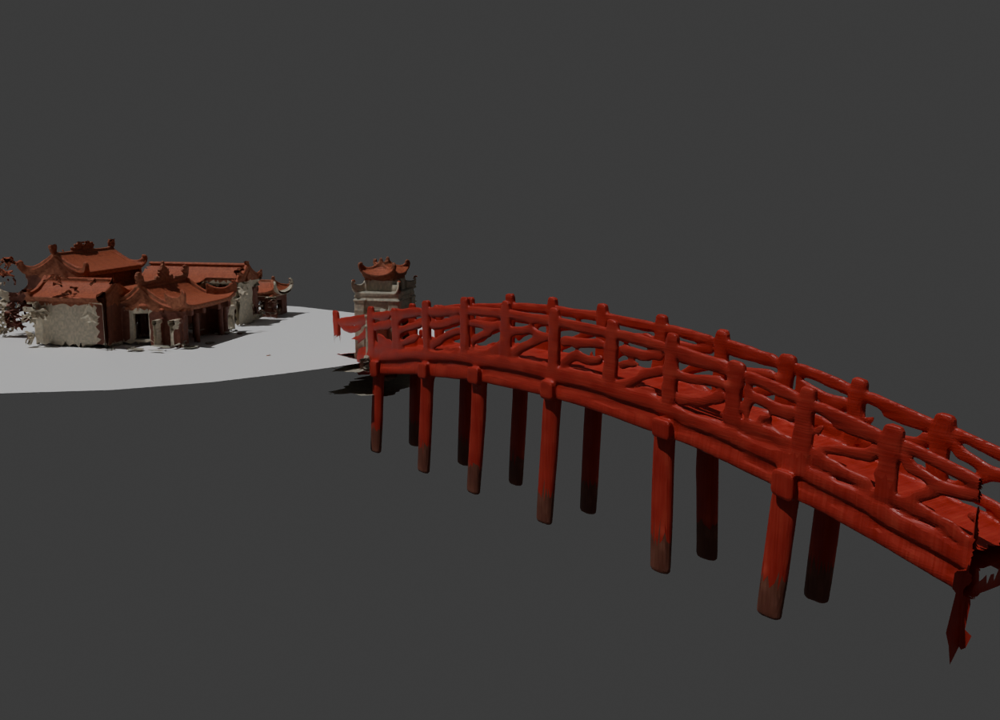
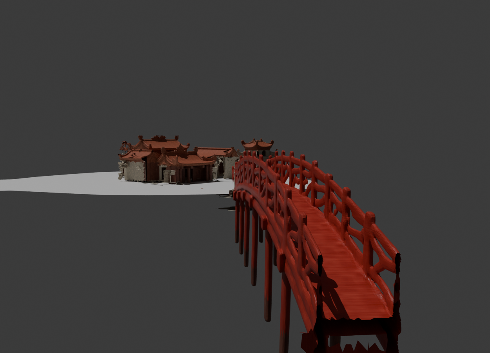
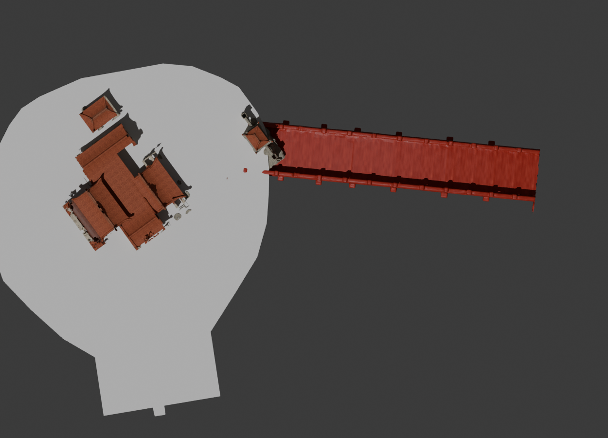
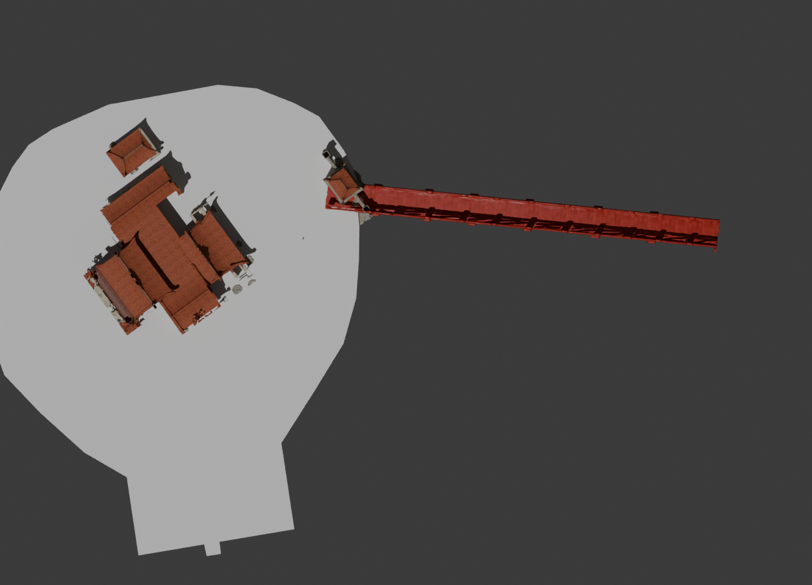
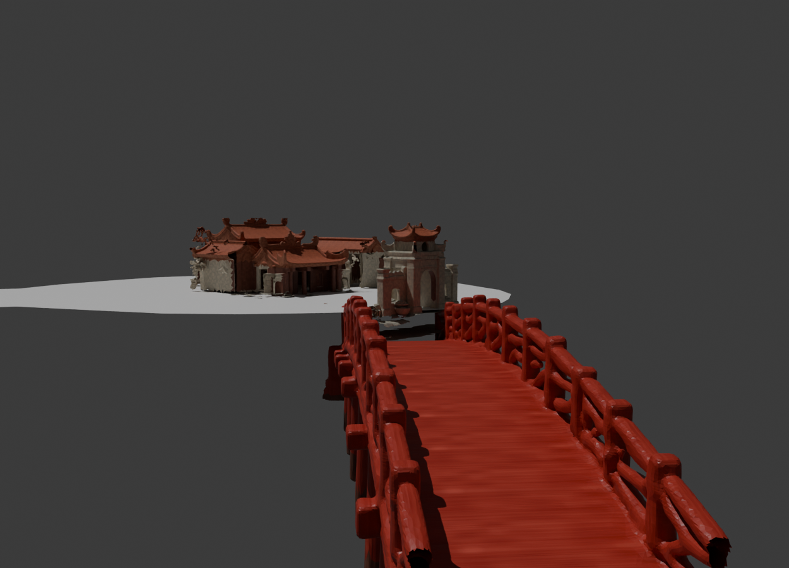
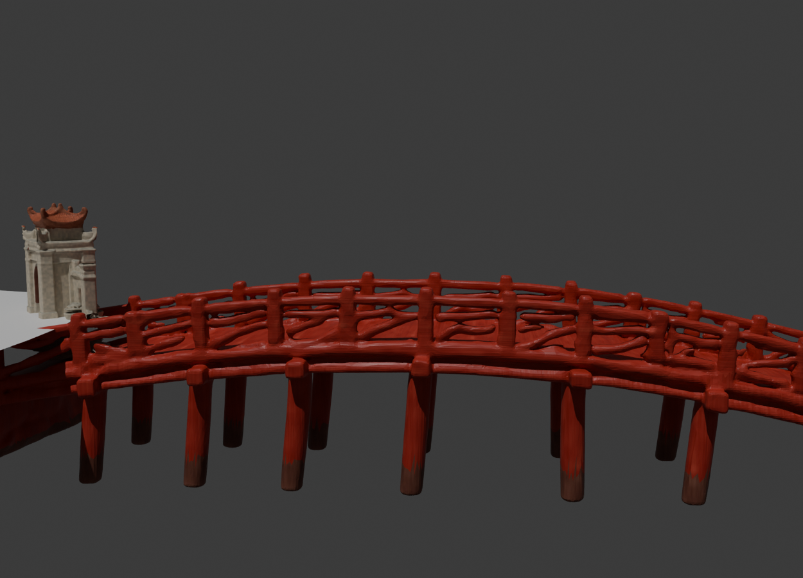
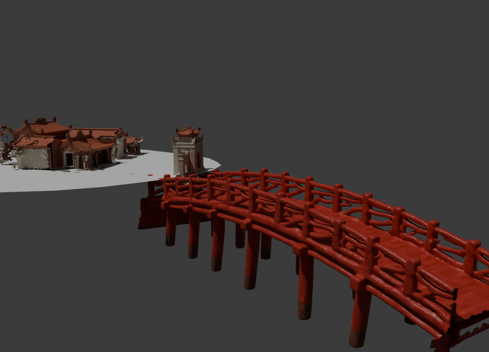

> Lịch sử đến commit 32c3512. Trạng thái hiện tại và ảnh gameplay xem trong [báo cáo PR #4](BRIDGE_INTEGRATION_QA.md).

# Cầu Thê Húc / Đền Ngọc Sơn — kiểm tra nhánh Preview

**Trạng thái:** Đang chờ kiểm duyệt hình ảnh, chưa được merge vào `main`. Cầu lấy từ Blender do chủ dự án cung cấp và chỉnh mesh trên nhánh PR #4. Render dưới đây là Blender, **không phải ảnh gameplay WebGL**. Preview Vercel yêu cầu đăng nhập trong trình duyệt của tác nhân; kiểm tra WebGL dưới đây được thực hiện với production build local và chưa xác nhận trên URL Preview đã triển khai.

## Kiểm tra chồng mô hình

- `Landmarks` tạo đúng một `LandmarkSlot` cho đền và một cho cầu. Khi GLB tải thành công, fallback procedural không được mount. `Suspense` không còn vẽ bản cũ trong thời gian tải; fallback chỉ xuất hiện nếu GLB lỗi.
- `den-ngoc-son-heritage.glb` có **sáu mesh theo vật liệu**: diềm mái, gỗ, sân gạch, đá bậc, ngói, vữa tường. Không có mesh cầu đỏ hoặc mesh kiến trúc procedural bên trong GLB; không phát hiện hai bản chính điện/cổng trùng nhau trong scene graph. Giữ sân gạch và công trình phụ, không xóa nhầm. Kiểm tra này chưa thay thế việc quan sát WebGL.
- `Landscape.tsx` tạo mặt đảo cỏ phẳng và mép đảo; đây là địa hình nền, không phải một bản đền khác. GLB sân gạch có cao độ local 1,275–1,900 m. Hạ transform đền từ Y=0,28 xuống **Y=-1,55 m** làm mặt sân cao khoảng 0,35 m trong game, ngang đầu cầu; phần chân đá thấp được nền đảo che. GLB và texture không bị sửa.
- Dải đá từ bờ phía đông trong `Landscape.tsx` là lối tiếp cận cầu dài 22 m; mép của nó chỉ phủ khoảng 1 m đầu cầu, không phải một cầu thứ hai.
- `thap-rua-heritage.glb` vẫn cùng một mesh, bounds 7,01 × 5,79 × 8,80 m và không đổi byte. Đảo Tháp Rùa rộng khoảng 22,2 × 26,4 m; nền cỏ trong `Landscape.tsx` ở Y=0,28 m, đúng với chân GLB (local Y=0). Vì vậy có diện tích cỏ lộ ra quanh chân tháp theo hình học, nhưng màu thực tế WebGL chưa được xác nhận bằng ảnh.

## Mesh cầu nguồn và phép căn

Script `scripts/heritage/export-game-bridge.py` lấy ba nhóm từ `heritage-optimized-working.blend`: cầu sơn son, ván gỗ, và các trụ gỗ dọc nhịp. Phiên bản PR #4 đầu tiên rộng quá mức. Bản sửa thu mặt ván và các dải lan can/trụ **riêng theo vùng mặt cắt trong mesh Blender**, đồng thời loại hai mảnh gỗ không thuộc hàng trụ và tấm chắn thấp không thuộc mặt đi bộ ở đầu đảo; giữ nguyên tọa độ dọc và cao độ vòm. File Blender gốc không bị ghi đè. GLB mới **107.731 tam giác**, **3 vật liệu PBR**, **2.048.452 byte**; texture WebP và Draco.

| Chỉ số | PR #4 trước sửa | Sau sửa | Mốc đối chiếu |
| --- | ---: | ---: | --- |
| Chiều dài | 46,73 m gồm gờ thừa | **46,26 m** từ đầu tới cuối mặt ván | Hai đầu OSM cách 46,26 m |
| Mặt ván rộng | khoảng 7,2 m | **3,00 m** | Ước lượng hình ảnh, chưa có số đo thực độc lập |
| Bề rộng gồm lan can | khoảng 11,6 m | **4,24 m** | Cổng đền nay rộng hơn đầu cầu trong render từ trên |
| Gờ cong mặt ván | khoảng 2,4 m | khoảng **2,4 m** | Giữ profile dọc, collision dùng đường cong sin |

GLB cầu có gốc tại đầu bờ đông, trục local `-X` chỉ về đảo. `Landmarks` đặt tại `bridgeStart`, Y=0,35 m, xoay khoảng **-0,099 rad** theo đường OSM. Đền vẫn đặt tại `[templeCenter.x + 4, -1.55, templeCenter.z - 12]`, xoay khoảng **+0,635 rad**. Ảnh từ trên cho thấy cầu mới chạm lối vào thay vì phủ rộng cả cổng. Đây là chỉnh hình học trong mesh Blender, không phải scale object không đồng nhất lúc render.

## Sửa lỗi cầu chìm dưới nước trong WebGL

Kiểm tra bản build local ngày 2026-11-19 với `?assetDebug=1#play` xác nhận **GLB đã tải**, nhưng từ bờ hồ chỉ thấy hai dải lan can đỏ, không thấy mặt ván. Vì Blender render không có mặt nước, ảnh so sánh cũ đã không bộc lộ lỗi cao độ. Phân tích GLB sau khi import lại: mặt ván ở đầu bờ có cao độ trung vị local khoảng **-3,27 m**, đầu đảo **-2,93 m**, trong khi transform đặt cầu ở Y=0,35 m. Phần lớn mặt ván bị nước hồ che. Đây là nguyên nhân cụ thể khiến Preview `d2bb862` trông như cầu cũ từ góc nhìn gameplay, dù file GLB thực ra đã tải.

Trong `export-game-bridge.py`, các đỉnh của cả ba nhóm mesh được nâng theo trục đứng **3,27 m ở bờ** và **2,93 m ở đảo**, nội suy dọc nhịp. Phép dịch giữ nguyên bề rộng 3,00 m, chiều dài 46,26 m và độ cong; mặt đi bộ nay ở gần cao độ collision (hai đầu khoảng 0,35 m trong game, giữa cầu khoảng 2,75 m). GLB mới có **107.731 tam giác, 3 vật liệu, 2.050.600 byte**. Các trụ dưới mặt ván vẫn kéo xuống nước; cần duyệt hình thức lan can và chân trụ trên Preview.

Khi tải lại production build local bằng WebGL, HUD báo `Cầu Thê Húc: GLB đã tải`; từ bờ thấy toàn bộ sàn đỏ, không còn chỉ hai dải lan can. Bấm `W` khoảng 3 giây đưa nhân vật từ tọa độ HUD `(54, -213)` tới `(38, -215)`, đi vào đầu cầu mà không rơi xuống nước. Console không ghi lỗi mức `error` trong lần kiểm tra này. HUD báo khoảng **43–60 FPS tức thời** ở cửa sổ **902 × 603 px**, không phải phép đo 1080p trên máy tầm trung. Các kết quả này chứng minh lỗi hiển thị local đã được sửa; cần xác nhận lại bằng Preview cùng mã commit và hình chụp ở góc bờ hồ, drone trước khi merge.

## Đối chiếu bằng ảnh

Ảnh thật chỉ dùng làm tham chiếu, nhúng từ Wikimedia Commons, không lưu trong repo. Các góc render gần tương ứng nhưng không khớp chính xác tiêu cự và vị trí máy ảnh; vì vậy đây là bằng chứng để duyệt, chưa phải chứng nhận đạt kiến trúc.

| Ảnh thật | Render GLB từ Blender |
| --- | --- |
| **Mặt bên** — [Myrabella, 2007, CC BY-SA 4.0](https://commons.wikimedia.org/wiki/File:The_Huc_Bridge.jpg).  |  |
| **Góc chéo nhìn cổng** — [Jakub Hałun, 2024, CC BY 4.0](https://commons.wikimedia.org/wiki/File:Huc_Bridge_in_Hanoi,_Vietnam,_20240204_1301_5726.jpg).  |  |
| **Toàn nhịp từ bờ hồ** — [David Stanley, 2025, CC BY 2.0](https://commons.wikimedia.org/wiki/File:Huc_Bridge.jpg).  |  |

### Trước / sau ở đúng camera Blender

| Camera | PR #4 trước sửa | Sau sửa |
| --- | --- | --- |
| Từ trên, cổng đền |  |  |
| Từ bờ nhìn vào cổng |  |  |
| Mặt bên |  |  |
| Góc chéo |  |  |

**Sai khác còn lại:** lan can và cột đỡ vẫn có họa tiết dày hơn ảnh thật, nguồn đền còn vài mép mesh đá gồ ghề. Render Blender mặt bên vẫn cho thấy một số mesh thấp dưới mép đảo; cần xem chúng bị nước che hay lộ ra trong WebGL. Ảnh đối chiếu chưa khớp chính xác tiêu cự. Chưa có ảnh gameplay WebGL hay góc drone đầy đủ ba công trình, nên không đánh dấu QA hình ảnh là PASS.

## Kiểm tra gameplay còn cần làm

Va chạm cầu trên nhánh Preview cho đi trong phạm vi **1,25 m** hai bên tâm của mặt ván rộng 3,00 m, và đưa chân nhân vật từ 0,35 m ở hai đầu lên khoảng 2,75 m giữa cầu. Lần thử local mới đi vào đầu cầu, chưa đi hết nhịp. Phải đi thử toàn bộ nhịp trong WebGL Preview, xem console và đo FPS 1920×1080 trên GPU thật trước khi merge. GLB đền, cầu và nền cỏ Tháp Rùa cần chụp từ camera bờ hồ và drone. Build thành công không thay thế các bước này.
