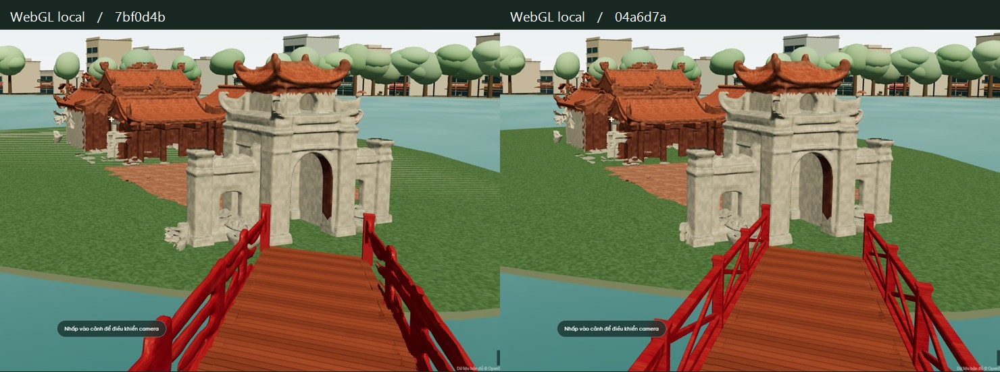
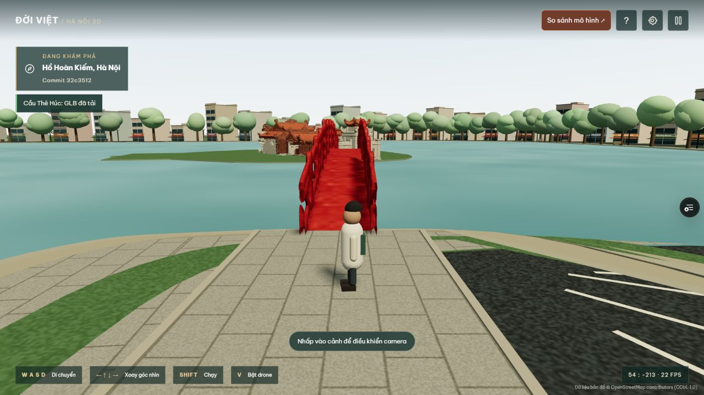
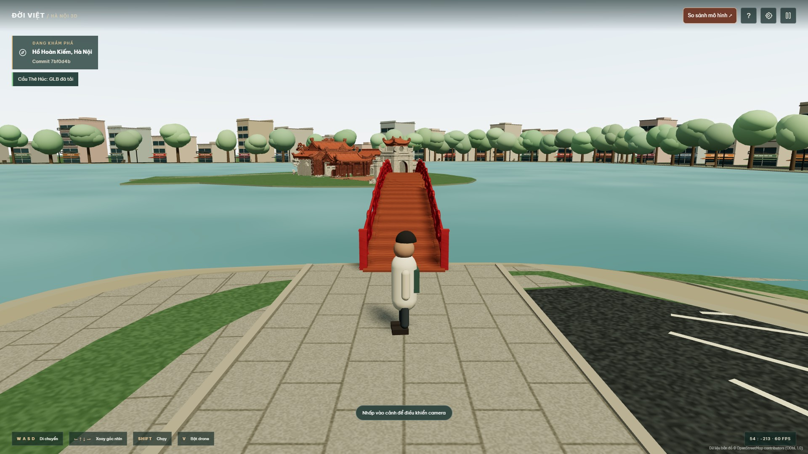
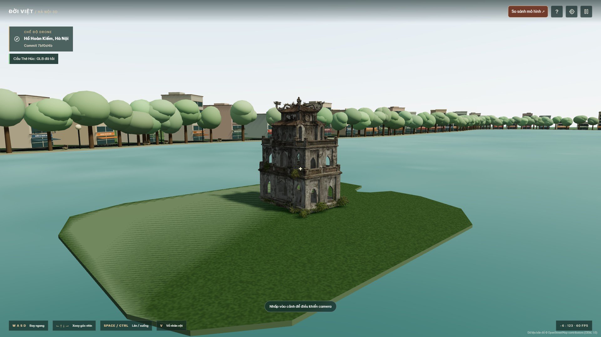
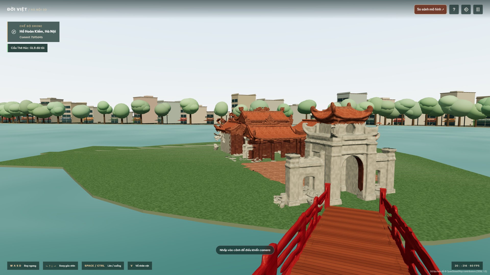
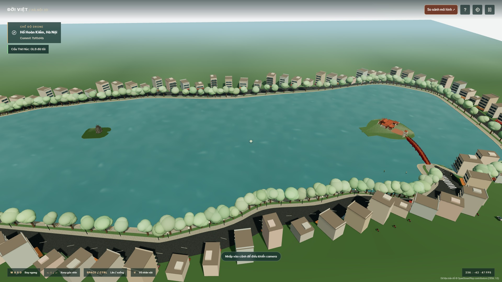
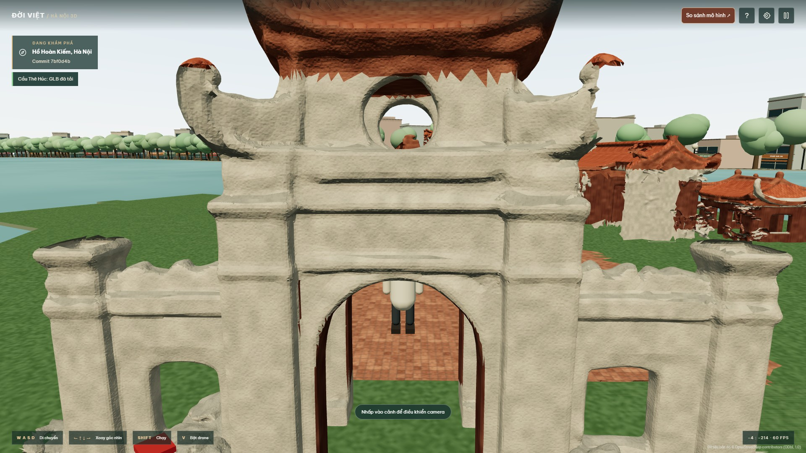

# Cầu Thê Húc · PR #4

## Sửa lan can và chân cổng · bản game `04a6d7a`

Hai ảnh dưới đây lấy từ production build chạy local, cùng camera drone nhìn từ cầu về đền, cùng khung hình gốc 1920 × 1080, DPR 1. Ảnh ghép cắt cùng một vùng trên hai khung hình để nhìn rõ từng thanh gỗ. Bên trái là `7bf0d4b`, bên phải là `04a6d7a`.

- **Cầu.** Trên bản cũ, mép các thanh chéo bị xé thành các mảnh đỏ. Script Blender dựng lại phần gỗ phía trên sàn theo tâm cột của mô hình nguồn, có tay vịn và các thanh chéo nối kín. Một vị trí cột tại 37,55 m được nội suy do thiếu dấu vết trên cả hai bên. Sàn và trụ chịu lực lấy từ cùng mô hình. GLB giảm từ 104.971 xuống 46.460 tam giác, còn 900.296 byte. Sau khi nhập lại GLB, 13.485 tia kiểm tra đều gặp sàn.
- **Đền.** Lớp cỏ và mặt trên của khối đảo ở cùng cao độ 0,28 m gây sọc. Bản sửa dùng lớp cỏ làm mặt trên và giữ mặt kè xung quanh. Ở bản sao đền dùng trong gameplay, lọc 2.609 tam giác đá/vữa nhô ra phía ngoài chân trụ cổng. Tệp GLB đền và Tháp Rùa giữ cùng nội dung với `7bf0d4b`. Trong ảnh sau, phía hậu điện vẫn còn viền tường vỡ và mảnh sáng gần sát nền. Các mặt này kết nối với tường gốc. Chất lượng hình học của hậu điện vẫn cần chỉnh trong nguồn Blender.
- **Kiểm tra local.** TypeScript, build production, kiểm tra bản đồ và va chạm đều đạt. Gửi phím đi bộ vào bộ điều khiển thực tế, nhân vật từ bờ đi hết cầu, qua vòm và tới sân ở x/z xấp xỉ (−4, −214). Console JS ghi 0 lỗi. [Tọa độ hành trình](heritage-images/webgl-04a6d7a/walk.json) · [console](heritage-images/webgl-04a6d7a/console-errors.json) · [hiệu năng](BRIDGE_PERFORMANCE.md).
- **Vercel Preview.** GitHub ghi trạng thái thành công cho deployment của dự án `vietnam-life-simulator` tại commit `04a6d7a`. Kết nối Vercel của phiên QA không mở được URL có bảo vệ. Công cụ điều khiển Chrome dừng khi không xác định được URL đủ tin cậy để mở tab Preview. Ảnh chụp và kiểm tra đi bộ ở đây sử dụng bản local. [Deployment](https://vercel.com/ducanhda3011-9281/vietnam-life-simulator/8gp5WDNnmwV5XTuuqLrn1ZyE7jgL).

Cuối nhịp cầu còn một đoạn cỏ ngắn trước vòm. Sân gạch bắt đầu phía sau cổng. Mép ngoài chân trụ còn một mẩu sáng nhỏ và camera góc ba che một phần nhân vật khi vừa qua vòm. Ảnh Tháp Rùa cho thấy sọc sáng cũ ở nửa trái nền cỏ đảo riêng của tháp. Đợt sửa này chỉ xử lý mặt đảo Ngọc Sơn.

| Góc máy | Ảnh WebGL đầy đủ · local · `04a6d7a` |
| --- | --- |
| Tháp Rùa và nền cỏ | [Mở ảnh](heritage-images/webgl-04a6d7a/tower.jpg) |
| Đền Ngọc Sơn từ cầu | [Mở ảnh](heritage-images/webgl-04a6d7a/temple.jpg) |
| Cầu Thê Húc từ bờ | [Mở ảnh](heritage-images/webgl-04a6d7a/shore.jpg) |
| Drone trên hồ | [Mở ảnh](heritage-images/webgl-04a6d7a/lake.jpg) |

## Đợt kiểm tra trước · `7bf0d4b`

Điểm xuất phát là `32c3512`. [Lịch sử thử nghiệm và ảnh tham chiếu cầu thật](BRIDGE_INTEGRATION_HISTORY.md).

## Những gì thay đổi từ 32c3512

- **Đầu bờ:** dò từ trên xuống mesh cũ ở cách đầu nhịp 5 cm không gặp ván trên dải đi bộ 2,5 m. Cách đầu nhịp 35 cm, mặt ván thấp hơn mốc model khoảng 21 cm và bị đường dẫn che. Script Blender cắt thẳng 60 cm cuối mặt ván, bổ sung ngưỡng gỗ kín hai đầu và hai dải ván mép rộng 22 cm.
- **Lan can và sàn:** giữ lưới thanh chéo và thân cầu từ Blender nguồn. Hạ tay vịn giữa nhịp từ khoảng 2,4–2,5 m xuống 1,0–1,05 m trên sàn, thu bề dày phần nổi của lan can. Gờ nối ván cách nhau khoảng 22 cm thể hiện bằng màu và normal map trên mặt đi liên tục. Bề rộng sàn 3,00 m, lối đi 2,50 m, hai mốc đầu cầu cách nhau 46,256 m.
- **Kiểm tra GLB đã xuất:** 104.971 tam giác, 3 vật liệu PBR, 2.022.224 byte. Khi nhập lại GLB, cả 13.485 tia đều gặp mặt ván. Sai số cao độ lớn nhất trong dải đi bộ là 5,13 cm. Đường viền vài thanh chéo còn gồ ghề từ mesh nguồn.
- **Cổng đền:** tâm cửa cũ lệch trục cầu 2,40 m và nằm lùi trên nhịp 3,13 m. Dịch nguyên GLB và giữ hướng cũ để toàn bộ đền vẫn nằm trên đảo. Tâm cửa nay cách đầu cầu phía đảo 1,55 m. Nhân vật đi thẳng qua cầu rồi rẽ trái khoảng 42° qua cửa vào sân. Va chạm của bản dự phòng giữ quy tắc riêng.
- **Sân gạch:** kiểm tra mesh cho thấy ở điểm sân bên trong cửa, gạch cũ ở Y=-0,242 m, dưới cỏ 0,522 m. Nâng riêng mesh vật liệu gạch của bản sao dùng trong gameplay thêm 0,594 m. Sau sửa, mặt gạch ở điểm đó cao 0,352 m, mặt đi là 0,350 m. Có thể đối chiếu [ảnh sân bị cỏ che · local dea8192](heritage-images/webgl-7bf0d4b/before-yard-local-dea8192.jpg) với ảnh đền từ cùng camera dưới đây.
- **Tháp Rùa và đền:** blob Git của hai GLB lần lượt là `d4e28093c9ca9ca558f8828d32412c4acdd25219` và `d979610c990b498bbcae34c977eb4c77dd8ac285`, bằng phiên bản `32c3512`. Transform Tháp Rùa và địa hình đảo được giữ nguyên.

## Đường đi và va chạm

| Mốc | X | Y | Z |
| --- | ---: | ---: | ---: |
| Bờ | 48,63 | 0,35 | -213,47 |
| Giữa nhịp | 25,61 | 2,75 | -215,75 |
| Đầu đảo | 2,60 | 0,35 | -218,03 |
| Trước cửa | 1,06 | 0,35 | -218,18 |
| Sau cửa | -1,43 | 0,35 | -216,35 |
| Sân | -3,32 | 0,35 | -214,96 |

`node scripts/check-bridge-walk.mjs` kiểm tra đi và chạy theo các mốc trên ở bước mô phỏng 50 ms, gồm kiểm tra chắn hai bên lan can và trụ cổng. `scripts/heritage/check-gate-clearance.py` kiểm tra lối qua GLB đền thật bằng Blender: 18 tia qua được khoảng mở; hai tia đối chứng bị chặn bởi hai trụ. Collision của các gian đền là hộp đơn giản.

## Cách mở lại cùng góc máy

Trên bản local hoặc Preview, mở `/?assetDebug=1#play` để xem cầu từ bờ. Dùng `/?assetDebug=1&view=temple#play`, `view=tower` hoặc `view=lake` để mở góc nhìn từ cầu, đảo Tháp Rùa hoặc toàn cảnh hồ. HUD hiển thị SHA và trạng thái tải mô hình cầu. Drone vẫn cho phép di chuyển sau khi mở góc cố định.

## Bằng chứng WebGL

Hai ảnh từ bờ dùng cùng FOV và hướng nhìn. Điểm xuất phát dịch ngang 0,54 m để nhân vật đứng trên trục cầu. Bản trước chụp trên Vercel ở 1280 × 720, bản sau chụp local ở 1920 × 1080.

| Trước · Vercel Preview · 32c3512 | Sau · local · 7bf0d4b |
| --- | --- |
|  |  |

| Local · 7bf0d4b | Local · 7bf0d4b |
| --- | --- |
| **Tháp Rùa và cỏ.**  | **Đền từ cầu.**  |
| **Toàn cảnh ba công trình.**  | **Sau khi nhân vật qua cổng.**  |

**Kết quả local.** Cỏ xanh nhìn thấy quanh chân tháp. Đỉnh thấp nhất của model tiếp xúc mặt cỏ ở Y=0,28 m; không có đỉnh xuyên xuống bên dưới hoặc tam giác đáy đồng phẳng với cỏ ở dung sai 0,1 mm. Khoảng cách nhỏ nhất từ bốn góc bao chân tháp tới mép đảo là 5,83 m. Qua ảnh đền còn thấy đường viền gồ ghề và mảnh tường sáng ở sát nền. Lan can nguồn còn vài thanh chéo không đều.

Trong bản build production local, bộ thử phát sự kiện W và mũi tên trái vào bộ điều khiển bàn phím của game. HUD đi từ (54, -213), qua (24, -216), tới cửa (1, -218) rồi qua vòm và dừng trong sân tại (-4, -214). Khi nhân vật vừa qua cửa, mái cổng che một phần nhân vật trong camera góc ba. [Tọa độ quan sát trên HUD](heritage-images/webgl-7bf0d4b/walk.json).

Kiểm tra TypeScript, production build, bản đồ và va chạm đều đạt. Vite còn cảnh báo bundle chính khoảng 1,20 MB trước gzip. [Console JS local](heritage-images/webgl-7bf0d4b/console-errors.json) không có lỗi trong lần thử. Khi đổi High → Low → Medium → High, mỗi canvas cũ được gỡ và phát sự kiện mất WebGL context, trong scene còn một canvas. Kích thước trong [log chuyển cấu hình](heritage-images/webgl-7bf0d4b/quality-switch.json) được lấy ngay lúc thay canvas, trước khi render ổn định. Xem [báo cáo hiệu năng](BRIDGE_PERFORMANCE.md) để biết drawing buffer thực, thời gian CPU/GPU và FPS theo từng chế độ.

**Vercel Preview.** GitHub ghi nhận deployment `vietnam-life-simulator` thành công cho `7bf0d4b`. Trong phiên thử này, URL nhánh trả HTTP 302 tới trang SSO của Vercel. Bốn góc bản mới và hành trình qua cổng bên trên là ảnh local của đúng mã nguồn đó. Chưa đo được FPS hay xác nhận hình ảnh bản mới trong phiên Vercel đã đăng nhập.
