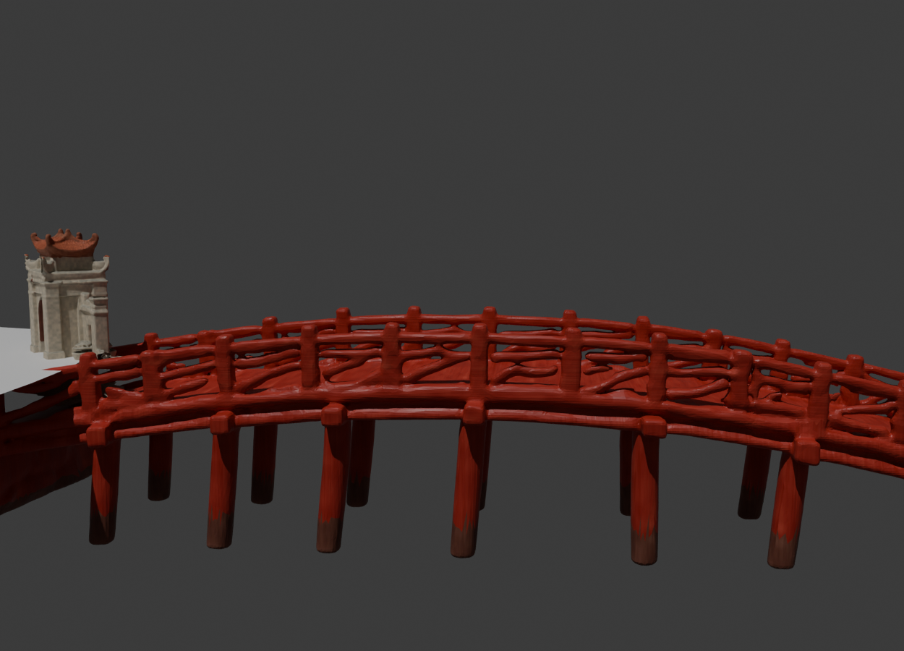
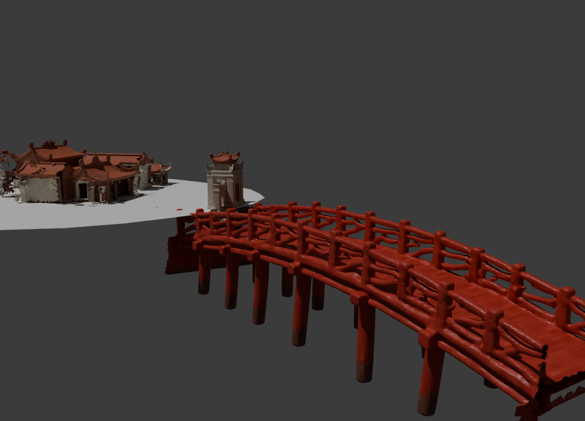
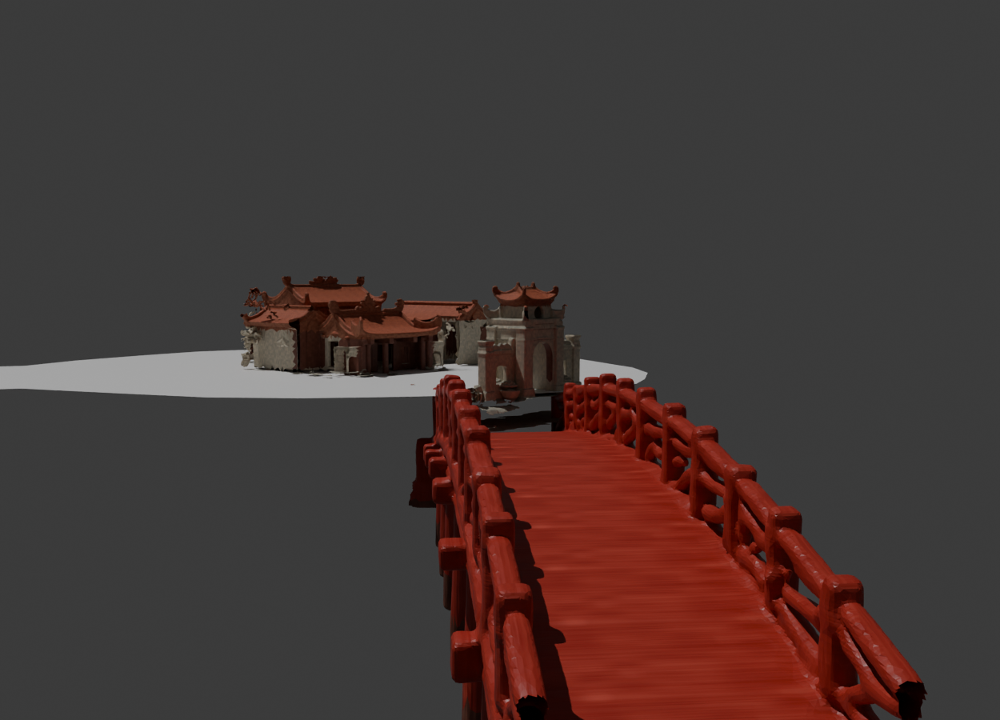
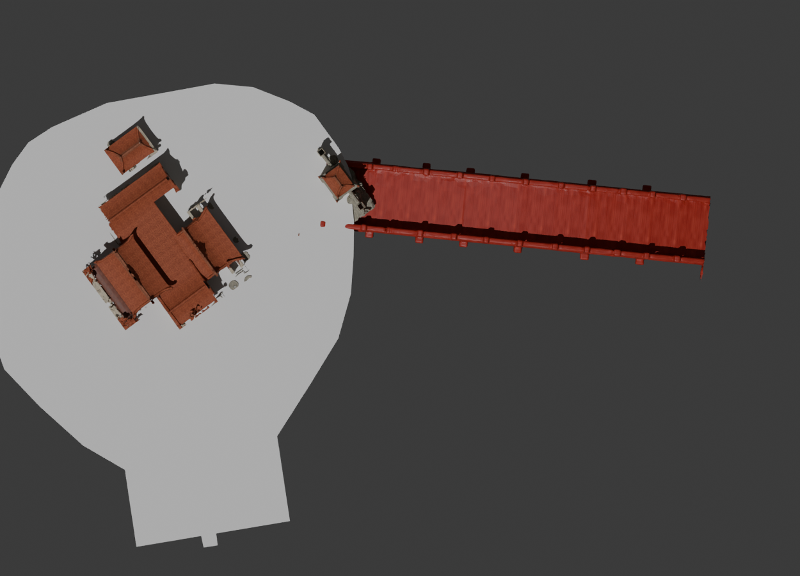

# Cầu Thê Húc / Đền Ngọc Sơn — kiểm tra nhánh Preview

**Trạng thái:** Chưa đạt kiểm duyệt hình ảnh, chưa được merge vào `main`. Đây là bản tách cầu từ file Blender do chủ dự án cung cấp, không phải cầu dựng lại bằng code. Render dưới đây là Blender, **không phải ảnh gameplay WebGL**.

## Kiểm tra chồng mô hình

- `Landmarks` tạo đúng một `LandmarkSlot` cho đền và một cho cầu. Khi GLB tải thành công, fallback procedural không được mount. `Suspense` không còn vẽ bản cũ trong thời gian tải; fallback chỉ xuất hiện nếu GLB lỗi.
- `den-ngoc-son-heritage.glb` có **sáu mesh theo vật liệu**: diềm mái, gỗ, sân gạch, đá bậc, ngói, vữa tường. Không có mesh cầu đỏ hoặc mesh kiến trúc procedural bên trong GLB; không phát hiện hai bản chính điện/cổng trùng nhau trong scene graph. Giữ sân gạch và công trình phụ, không xóa nhầm.
- `Landscape.tsx` tạo mặt đảo cỏ phẳng và mép đảo; đây là địa hình nền, không phải một bản đền khác. GLB sân gạch có cao độ local 1,275–1,900 m. Hạ transform đền từ Y=0,28 xuống **Y=-1,55 m** làm mặt sân cao khoảng 0,35 m trong game, ngang đầu cầu; phần chân đá thấp được nền đảo che. GLB và texture không bị sửa.
- Dải đá từ bờ phía đông trong `Landscape.tsx` là lối tiếp cận cầu dài 22 m; mép của nó chỉ phủ khoảng 1 m đầu cầu, không phải một cầu thứ hai.

## Mesh cầu nguồn và phép căn

Script `scripts/heritage/export-game-bridge.py` lấy ba nhóm từ `heritage-optimized-working.blend`: cầu sơn son (102.819 tam giác), ván gỗ (5.622), và 4.729 tam giác gỗ chỉ thuộc đoạn cầu. Tổng **113.170 tam giác**, **3 vật liệu PBR**, **2.123.036 byte**; xuất GLB với texture WebP và Draco. File Blender gốc không bị ghi đè.

| Chỉ số | Blender nguồn | Trong game sau scale đồng nhất 0,397764 | Mốc đối chiếu |
| --- | ---: | ---: | --- |
| Chiều dài thân cầu | 116,29 đơn vị | 46,26 m; gờ cuối đến 46,73 m | Hai đầu OSM cách 46,26 m |
| Mặt ván rộng | khoảng 18,1 đơn vị | khoảng **7,2 m** | Cầu procedural cũ khoảng 2,7 m; ảnh thật cho thấy cầu thanh hơn rõ |
| Bề rộng gồm lan can | khoảng 29,2 đơn vị | khoảng **11,6 m** | Đầu cổng đền hẹp hơn cầu |
| Gờ cong mặt ván | khoảng 6 đơn vị | khoảng **2,4 m** | Collision dùng đường cong sin cùng biên độ |

GLB cầu có gốc tại đầu bờ đông, trục local `-X` chỉ về đảo. `Landmarks` đặt tại `bridgeStart`, Y=0,35 m, xoay khoảng **-0,099 rad** theo đường OSM. Đền vẫn đặt tại `[templeCenter.x + 4, -1.55, templeCenter.z - 12]`, xoay khoảng **+0,635 rad**. Ảnh từ trên cho thấy cầu chạm cổng, nhưng bề rộng không phù hợp tỷ lệ công trình và cầu ngoài đời. Không được bóp riêng trục ngang vì sẽ biến dạng asset. Hướng xử lý nếu không chấp nhận bản cầu rộng: chủ dự án chỉnh tỉ lệ hình học trong Blender ở nguồn, hoặc dùng scale đồng nhất nhỏ hơn và tạo lối tiếp cận ngắn ở hai đầu; cần duyệt bố cục mới trước khi thay live.

## Đối chiếu bằng ảnh

Ảnh thật chỉ dùng làm tham chiếu, nhúng từ Wikimedia Commons, không lưu trong repo. Các góc render gần tương ứng nhưng không khớp chính xác tiêu cự và vị trí máy ảnh; vì vậy đây là bằng chứng để duyệt, chưa phải chứng nhận đạt kiến trúc.

| Ảnh thật | Render GLB từ Blender |
| --- | --- |
| **Mặt bên** — [Myrabella, 2007, CC BY-SA 4.0](https://commons.wikimedia.org/wiki/File:The_Huc_Bridge.jpg).  |  |
| **Góc chéo nhìn cổng** — [Jakub Hałun, 2024, CC BY 4.0](https://commons.wikimedia.org/wiki/File:Huc_Bridge_in_Hanoi,_Vietnam,_20240204_1301_5726.jpg).  |  |
| **Toàn nhịp từ bờ hồ** — [David Stanley, 2025, CC BY 2.0](https://commons.wikimedia.org/wiki/File:Huc_Bridge.jpg).  |  |

**Sai khác còn lại:** cầu nguồn quá rộng khi căn đúng chiều dài; lan can và cột đỡ trông nặng hơn ảnh thật; nguồn đền còn vài mép mesh đá gồ ghề. Chưa có ảnh chính diện thật đủ gần để kết luận lối vào và lan can, nên không đánh dấu QA hình ảnh là PASS.

## Kiểm tra gameplay còn cần làm

Va chạm cầu trên nhánh Preview cho đi trong phạm vi 3,35 m hai bên tâm và đưa chân nhân vật từ 0,35 m ở hai đầu lên khoảng 2,75 m giữa cầu. Phải đi thử toàn bộ nhịp trong WebGL Preview, xem console và đo FPS 1920×1080 trên GPU thật trước khi merge. GLB đền, cầu và nền cỏ Tháp Rùa cần chụp từ camera bờ hồ và drone. Build thành công không thay thế các bước này.
