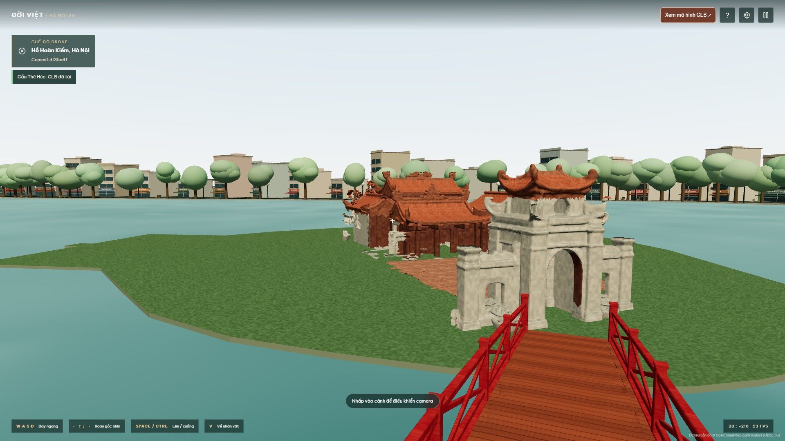
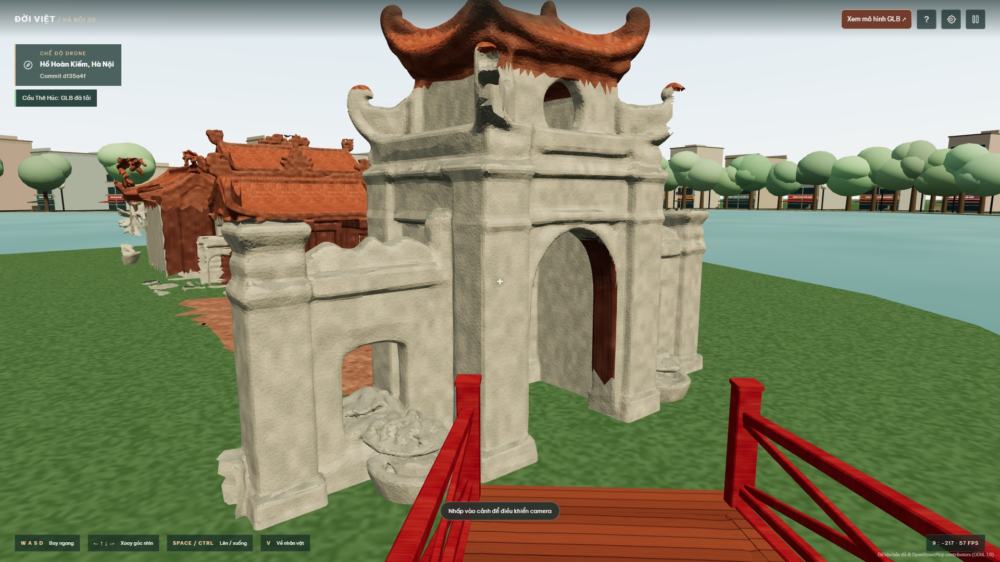
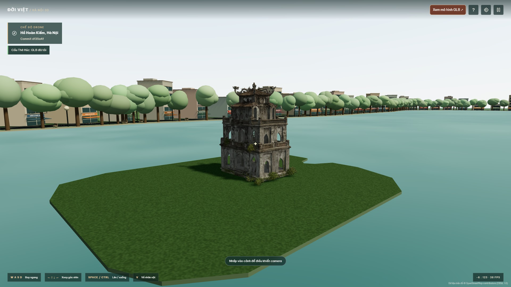

# Blender → WebGL · PR #4

Phiên bản gameplay `df35a4f`, ngày 19/11/2026. Trạng thái kiểm duyệt hình ảnh còn mở.

## Môi trường và nguồn

- Blender thực chạy tại `C:/Program Files/Blender Foundation/Blender 5.3/blender.exe`, phiên bản 5.3.0. Đã chạy background, gọi bpy, xuất GLB, nhập lại cả ba GLB và kiểm tra dữ liệu mesh/UV/texture.
- Nguồn tại `C:/Users/ducan/Documents/Codex/2026-11-10/t-n-game-taxi-h-n/outputs/TaxiHaNoiUE 5.8 - 4/HoGuom_NgocSon_Heritage_v2_DaTo.blend`, 430.041.049 byte. SHA256 `4BBEE851B152659210D2C23DA074CECDD4AF7B83B4F86A7ECA4BC768A0CA0B8B`.
- Hai mesh nguồn có 9.707.622 tam giác, 15 vật liệu, 32 ảnh. Không có ảnh ngoài bị thiếu, camera hoặc đèn trong nguồn. Các ảnh vật liệu được đóng gói. Scene nguồn Z hướng lên. Trong game Y hướng lên, đơn vị mét, vị trí lấy từ bản đồ.
- Bản sao tách theo vật liệu ở `heritage-work/heritage-optimized-working.blend`. Bản sửa đền được lưu riêng tại `heritage-work/temple-repaired.blend`. Tệp gốc được kiểm checksum trong pipeline.

## Asset sau xuất và nhập lại

| Asset | Byte trước → sau | Tam giác trước → sau | Vật liệu | Ảnh |
| --- | ---: | ---: | ---: | ---: |
| Tháp Rùa | 5.847.892 → 5.847.892 | 1.875.386 → 1.875.386 | 1 | 3 |
| Đền Ngọc Sơn | 9.067.808 → 9.029.724 | 476.273 → 473.664 | 6 | 18 |
| Cầu Thê Húc | 900.296 → 900.296 | 46.460 → 46.460 | 3 | 8 |

Mốc trước của bảng là đầu nhánh `06d6cb1`. Đền và cầu dùng ảnh 1024 px cùng texture ván nhỏ hơn. Tháp giữ ảnh 2048 px và SHA256 `7C6DC7E6B4483D8200DCB59B65E38D8EEBA8802D1C0296B5F84231CE4E06520A`. Các GLB dùng Draco, ảnh WebP và vật liệu PBR. Báo cáo nhập lại chi tiết ở `heritage-work/glb-verification.json`.

## Thay đổi

- `temple_finish.py` chuyển sửa chân trụ từ bộ lọc Three.js sang mesh Blender. Xóa đúng 1.396 tam giác đá và 1.213 tam giác vữa trong vùng ngoài chân trụ đã được đối chiếu ở đợt QA trước. Cao độ sân gạch tăng 0,594 m được ghi vào mesh nguồn xuất. Không giảm polygon mái, gỗ hoặc gốm.
- `export-game-temple.py` chỉ nhận bản sao chưa biến đổi, lưu riêng bản sửa, xuất GLB và JSON thống kê.
- `LandmarkModel.tsx` tải asset đã sửa, bỏ bộ lọc tam giác và phép nâng sân trong runtime. URL GLB đền có mã phiên bản để phân biệt cache.
- `Historic.tsx` hiện thông báo HTML khi bất kỳ công trình nào tải lỗi. Các đường procedural đã bị bỏ trong các commit trước của nhánh.
- `reviewViews.ts` bổ sung góc cổng và drone nhìn từ trên.
- `pipeline.ps1` kiểm nguồn, chạy xuất từng công trình, nhập lại GLB và so checksum nguồn/tháp. `verify-glbs.py` kiểm dữ liệu ảnh giải mã, UV, mesh hợp lệ và bounds. `assets-source/` được Git bỏ qua.

## Kiểm tra và giới hạn

`pnpm check:map`, `pnpm check:landmarks`, `node scripts/check-bridge-walk.mjs` và production build đều đạt. Blender kiểm 18 tia qua lối vòm, hai tia đối chứng gặp trụ. Bản kiểm tra đi bộ WebGL dùng phím W/mũi tên vào bộ điều khiển thực.

Các ảnh mới nằm trong `heritage-images/webgl-df35a4f/`, đều chụp production build local, 1920 × 1080, DPR 1. Script chờ dấu mount của đủ ba GLB. Đợt chụp thử `cc224d7` chờ theo request nên có ảnh đền chưa kịp giải mã. Các ảnh thử đó không dùng để nghiệm thu.

Đi bộ thực tế từ bờ qua giữa cầu, đầu đảo, vòm và vào sân kết thúc ở x/z (−4, −214). Console ghi 0 lỗi. [Hành trình](heritage-images/webgl-df35a4f/walk.json).

Hiệu năng đo ở 1920 × 1080, DPR 1, ít nhất 30 giây mỗi lượt. Low 51,01 FPS, Medium 44,00, High 41,85, High chuyển động 35,85. Mức FPS tại thời gian frame P99 lần lượt 35,59 / 29,67 / 29,50 / 29,67. Thiết bị Intel UHD và máy đang được sử dụng. [Bảng draw calls, thời gian CPU/GPU và dữ liệu gốc](BRIDGE_PERFORMANCE.md). Mục tiêu 60 FPS chưa đạt trong phiên này.

Vẫn thấy những mảng vữa trắng vỡ ở phía bên của chính điện, mép mái/cổng nham nhở và viền sân không đều. Đây là vùng mesh nguồn nối với kiến trúc chính, cần khoanh từng mảng và phục hồi topology theo ảnh trước khi sửa tiếp. Bộ kiểm tra mesh hợp lệ không xác nhận các vùng này đẹp hoặc đúng kiến trúc. Đoạn nối cầu tới vòm còn nền cỏ. Chất lượng đền chưa đạt điều kiện nghiệm thu toàn bộ.

Vercel connector trả 404 khi tra dự án và xin quyền truy cập URL nhánh. Chưa kiểm chứng cấu hình nhánh production trong tài khoản Vercel hoặc render trên Preview có đăng nhập. Cấu hình repository dùng Vite, `pnpm build`, output `dist`. Trạng thái deployment được đối chiếu riêng qua GitHub. PR tiếp tục ở dạng draft.
