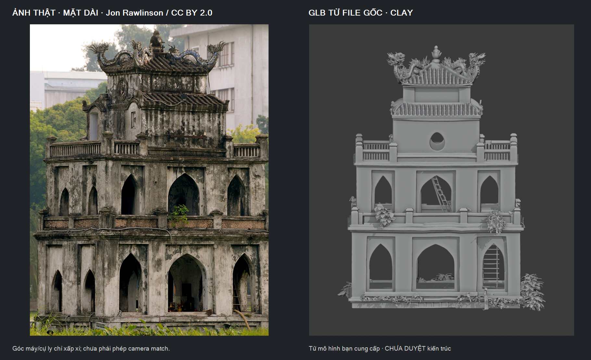
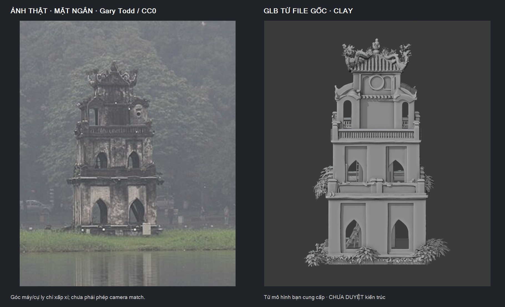
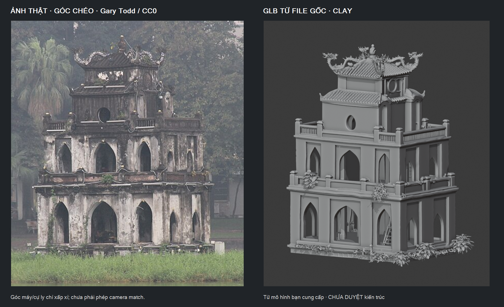
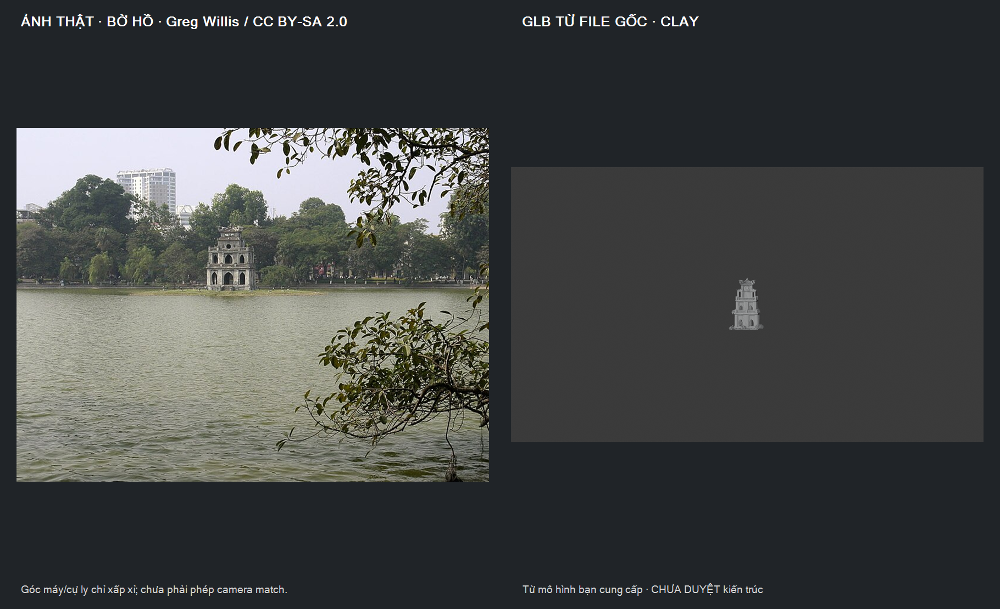

# Heritage source model — review pending

This draft imports only the user's existing `HoGuom_NgocSon_Heritage_v2_DaTo.blend` geometry. It does not replace the production landmark URLs. Do not merge or deploy the review assets as approved landmarks until the photographic and game-camera checks in [LANDMARK_VISUAL_QA.md](LANDMARK_VISUAL_QA.md) pass.

## Source and optimization

- Original `.blend`: 430,041,049 bytes (410.1 MiB), SHA-256 `4BBEE851B152659210D2C23DA074CECDD4AF7B83B4F86A7ECA4BC768A0CA0B8B`. The original was opened with Blender 5.3 and `--disable-autoexec`; it was not saved or overwritten.
- Same-name original `.glb`: 934,617,272 bytes (891.3 MiB); inspected as glTF 2.0, not used in the web game.
- Original scene: two mesh objects, 9,707,622 triangles, 15 materials, 30 used images (27 at 1024², three at 2048²), no missing unpacked images, no modifiers, cameras, lights or empty mesh objects. There were no duplicate **objects**; the scene was not audited for duplicate connected components.
- `Mesh_0.002` contains Tháp Rùa (1,875,386 triangles). `Mesh_0.003` combines Đền Ngọc Sơn, Cầu Thê Húc and landscape (7,832,236 triangles). The combined mesh was split by its 14 materials on a working copy. Only the two foliage groups were decimated to 22% of their original face count. All architecture, bridge geometry and the tower retained their original faces. Total: **4,652,504 triangles**, a 52.1% reduction. No source object was removed; no pre-existing modifier was applied. Only the two new foliage decimate modifiers were applied.
- Working Blender copy: 229,842,696 bytes (219.2 MiB), kept outside Git. Exported with Draco geometry and WebP quality 85, retaining the source UVs, PBR materials and textures. No 4K textures existed to downsize.
- Review tower GLB: [`thap-rua-game-review.glb`](../public/models/review/thap-rua-game-review.glb), 5,847,892 bytes, 1,875,386 triangles, one glTF material, three embedded images. Source dimensions were 93.55 × 77.18 × 117.37 Blender units; uniform factor **0.0749734149** and a base-centred origin produce **7.013 × 5.786 × 8.800 game metres**. This preserves proportions; it does not establish architectural accuracy. Place at existing `turtleCenter`, Y=0.28, rotation Y=0 for review only.
- Review temple/bridge GLB: [`ngoc-son-the-huc-review.glb`](../public/models/review/ngoc-son-the-huc-review.glb), 47,399,396 bytes, 2,777,117 triangles, 14 glTF materials, 27 embedded images. It preserves the relative Blender placement of the temple and bridge. It is displayed only in an isolated inspection viewport at scale 0.14; **no game-map transform has been approved**. Combined transfer is 53,247,288 bytes (50.8 MiB), slightly above the 50 MB goal. Most remaining bytes are geometry: ~45.9 MB in the combined asset. The temple and bridge are not safely separable by object name; material-only splitting would omit shared structural details or scenery.
- Blender glTF export warned `Mesh_0.001 is not valid, and may be exported wrongly` for the combined asset. Blender successfully imported the resulting GLB, recovering all 14 mesh groups and 2,777,117 triangles, but the warning remains a review risk.

## Visual evidence

The images below compare the supplied source with real photographs, **not** a newly modelled landmark. Camera angles and crops are approximate. The photo licensing and attribution apply to the photographic portion of each paired image; the renders are from the user-supplied model. Source dates were not established.

| View | Real photo, author and license | Pair |
| --- | --- | --- |
| Long facade | [Jon Rawlinson, *Tháp Rùa 5*, CC BY 2.0](https://commons.wikimedia.org/wiki/File:Th%C3%A1p_R%C3%B9a_5.jpg) | [Photo / GLB render](heritage-images/photo-pair-long.png) |
| Short facade | [Gary Todd, *Tortoise Tower in Hoan Kiem Lake*, CC0](https://commons.wikimedia.org/wiki/File:Tortoise_Tower_in_Hoan_Kiem_Lake_(9753113362).jpg) | [Photo / GLB render](heritage-images/photo-pair-short.png) |
| Oblique | [Gary Todd, *Thap Rua (Tortoise Tower) in Hoan Kiem Lake*, CC0](https://commons.wikimedia.org/wiki/File:Thap_Rua_(Tortoise_Tower)_in_Hoan_Kiem_Lake_(9753371474).jpg) | [Photo / GLB render](heritage-images/photo-pair-oblique.png) |
| Shore | [Greg Willis, *Hoan Kiem Lake from east*, CC BY-SA 2.0](https://commons.wikimedia.org/wiki/File:Hoan_Kiem_Lake_from_east_(3694364435).jpg) | [Photo / GLB render](heritage-images/photo-pair-shore.png) |

### Current differences

- **Massing:** the 8.8 m review tower has a 7.01 × 5.79 m footprint, larger than the 6.28 × 4.54 m reference dimensions previously supplied by the user. Uniform scaling cannot correct both footprint and height. The upper chamber and crest occupy a visibly larger share of height in the short and oblique comparisons.
- **Arches:** the model repeats crisp, regular openings; real photos show a less uniform rhythm and smaller subsidiary openings. The model also exposes interior ladders and geometric details more clearly than the reference.
- **Roof and top:** the source includes a highly symmetric, sharply detailed dragon crest and a box-like band below it. The actual weathered crest is more compact and irregular. The source's secondary roof is broad and regular. This is a **visual approval blocker**, not a texture issue.
- **Rails/terraces:** posts and balusters look thicker, straighter and cleaner than in photos. The two terrace bands stand out more strongly.
- **Shore:** the isolated GLB render has no lake/island context, so it cannot prove recognizability or scale at the game shoreline. The gameplay preview URL exists, but browser WebGL verification was blocked by an existing browser permission rule in this session.

Optimization itself left the large forms visually stable in these matching Blender cameras: [tower](heritage-images/before-after-tower.png), [temple and bridge](heritage-images/before-after-complex.png), [bridge closer](heritage-images/before-after-bridge.png). These comparisons do not prove the monuments are historically accurate.

## Preview and integration status

- `/#heritage-review` is an isolated orbit viewer for the two candidate GLBs. It loads the temple and bridge together, preserving their Blender relative positions.
- `/?heritagePreview=tower#play` switches **only Tháp Rùa** to the candidate GLB on this branch. The existing map position and collision remain unchanged; `LandmarkLoadBoundary` still falls back to the procedural model if loading fails. The normal `/#play` route continues to use the current production asset from `landmarkAssets.ts`.
- The combined source is about 243 × 454 × 78 Blender units. At a scale that fits the OSM temple island (about 0.2), its red bridge covers about 23 m, while OSM's bridge segment is 46.3 m and runs in a different direction. One uniform group transform cannot fit both island and bridge without a visible mismatch. Further non-destructive segmentation and review of placement is required before this asset can enter the gameplay map.
- No Vercel production deployment or merge was performed. The review GLBs are in this draft branch only.

## Verification and pending gates

- Blender round-trip: both GLBs imported; tower bounds 7.013 × 5.786 × 8.800 m and 1,875,386 triangles; combined asset 14 meshes and 2,777,117 triangles. Draco and WebP extensions are present.
- `pnpm build` passed (TypeScript + Vite); `pnpm check:map` passed. Vite warns that the main JS chunk exceeds 500 kB; this existed as a performance concern and needs a separate optimization pass.
- WebGL console, transfer time and 1920×1080 Low/High FPS **not measured**: the browser tool refused access to `http://127.0.0.1:5173` because a saved permission setting blocks network egress. No browser screenshot is claimed.
- **Visual review: pending / not passed.** Please review the four photographic pairs and the preview build. The roof, footprint and rail discrepancies must be resolved in the original authored asset if historical fidelity is required. Since this task forbids architectural edits, this PR does not change those shapes.

To reproduce the Blender processing, see [scripts/heritage/README.md](../scripts/heritage/README.md).
