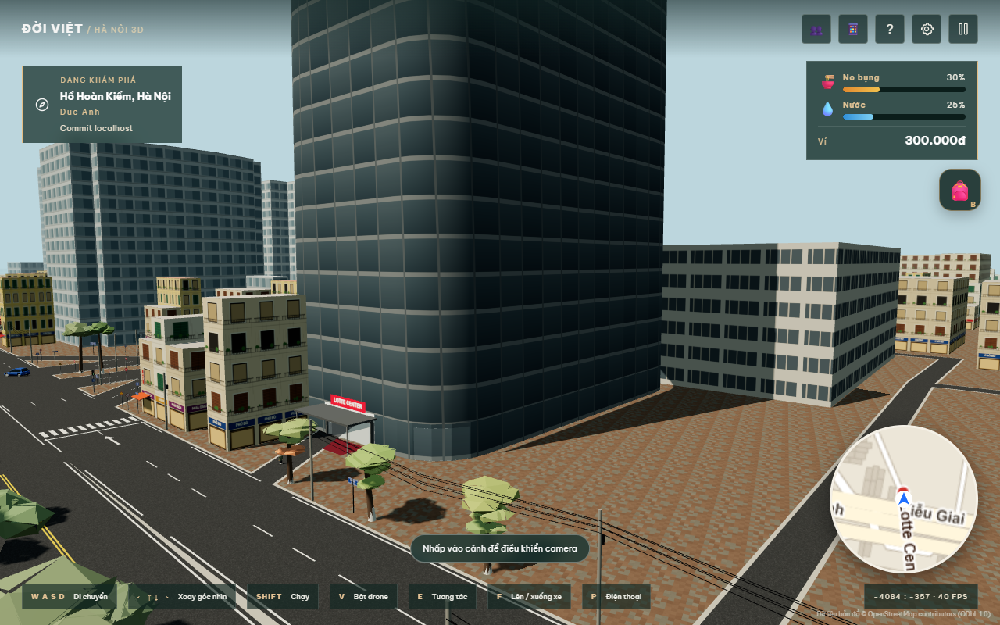

# Vòng 18: Lotte Center Hà Nội, giai đoạn 1 (ngoại thất)

Theo đặc tả 20 mục của chủ dự án ("vừa đọc vừa làm vừa so sánh"). Giai đoạn này chỉ làm phần ngoại thất. Hầm xe, siêu thị B1, trung tâm thương mại, đài quan sát và khách sạn là các giai đoạn sau.

## Dữ liệu dùng (đã kiểm chứng)

- **Mặt bằng và chiều cao:** lấy từ OpenStreetMap (© OpenStreetMap contributors, ODbL), đọc ngày 26/11/2026.
  - Way 727570330 `building:part` (65 tầng, cao 272 m, kính) là thân tháp. Mặt bằng hình nơ: dài ~88 m, rộng 38 m ở hai đầu, chỉ ~24 m ở giữa. Ở giữa, mỗi mặt dài có một khe rộng ~4 m, sâu 2–2,5 m.
  - Way 1195985607 `building:part` (6 tầng, cao 36 m, kính) là khối đế ôm phía nam và phía tây của tháp.
- **Tầng, khai trương, công năng:** theo Wikipedia và đặc tả. 65 tầng nổi, khai trương 02/09/2014.

## Ảnh tham chiếu (chỉ có link, không đưa ảnh của người khác vào repo)

| Ảnh | Góc nhìn | Dùng để đối chiếu |
|---|---|---|
| [znews.vn, 2014](https://photo.znews.vn/w1210/Uploaded/abhuuah/2014_07_31/lotte.jpg) ([bài](https://znews.vn/toa-thap-cao-thu-hai-viet-nam-truoc-dip-khanh-thanh-post441988.html)) | Từ trên cao, phía nam, nhìn lên phía bắc | Dáng hai lá, khe dọc, chữ LOTTE trên lá bên phải, khối đế kính xanh |
| [Thornton Tomasetti](https://www.thorntontomasetti.com/project/lotte-center-hanoi) | Ban đêm | Ô sáng không đều (trang chặn trình duyệt tự động, chưa xem được ảnh) |
| [tektrahomes](https://tektrahomes.vn/thue-toa-building/toa-van-phong-lotte-center-ha-noi-54-lieu-giai) | Khối đế | Kính hoa văn, mái che (chưa tải được ảnh) |

Ảnh ghép so sánh có dùng ảnh znews nên mình chỉ gửi riêng cho chủ dự án, không commit.

## Ảnh trong game

| | Trước (vòng 17) | Sau (vòng 18) |
|---|---|---|
| Từ trên cao |  |  |
| Khối đế |  |  |

Các góc khác sau khi sửa:
- [góc gần giống ảnh znews](lotte-sau-matched.png)
- [mặt dài](lotte-sau-broad.png)
- [đầu hồi phía đông](lotte-sau-end.png)
- [lối vào](lotte-sau-entrance.png)
- [đỉnh tháp](lotte-sau-top.png)
- ban đêm: [từ trên cao](lotte-dem-aerial.png), [mặt dài](lotte-dem-broad.png)

## Đã làm

- **Thân tháp:** dựng đúng mặt bằng OSM.
  - Hai lá nối nhau ở khe giữa; mỗi lá có hai mặt nghiêng nên bắt sáng khác nhau, giống ảnh.
  - Khe mở rộng và sâu dần lên đỉnh. Hai mép khe có gân nhôm dọc.
  - Thân hẹp lại ~4% ở giữa chiều cao rồi mở lại ở đỉnh. Chi tiết eo này là ước lượng từ ảnh.
- **Đỉnh:** mặt kính chạy cao thêm 4 m bao quanh sân thượng, mái ở 268 m, đỉnh ở 272 m.
- **Kính:** xanh #548EB4, sáng #A8CBDC, khung #B8C3C9.
  - Dùng một atlas cho cả mặt: 20 ô × 16 tầng, mỗi ô một sắc hơi khác.
  - Ban đêm có emissive map với ô sáng không đều; không dùng đèn riêng cho từng ô.
- **Chữ:** "LOTTE" màu đỏ #D51D32 trên lá phải của hai mặt dài và trên đầu hồi phía đông. Chỉ là chữ thường, không vẽ lại logo chính thức.
- **Khối đế:**
  - cao 36 m, 6 tầng × 6 m, kính xanh có khung hình thoi;
  - biển chữ "LOTTE CENTER Hanoi", "DEPARTMENT STORE", "LOTTE Mart", "LOTTE HOTEL";
  - một bảng quảng cáo tự vẽ (không dùng nhãn hiệu thật).
- **Lối vào phía đông (đường Liễu Giai):** mái che kính khung thép, 2 bậc đá xám thấp, bồn cây hai bên. Cửa kính lùa tự động và thang máy giữ nguyên như cũ.
- **Va chạm:** sàn mỗi tầng và tường tầng trệt đi theo mặt bằng mới. Đồ nội thất và đèn trần chỉ đặt bên trong mặt bằng.

## Kiểm tra (ghi đúng những gì đã chạy)

- Kiểm tra kiểu (`tsc --noEmit`) và `vite build` chạy sạch trên bản HEAD chỉ cộng 2 file của vòng này.
- Thang máy: vào cabin, chọn tầng 65; cabin lên tới nơi, nhân vật ở độ cao 259,5 m (đúng tầng 65).
  - Chưa thử được đi ra khỏi cabin bằng phím trong trình duyệt tự động.
- **FPS** (Edge headless, 1280×800, cùng máy):

  | Góc | FPS |
  |---|---|
  | Trước khi sửa | 38–42 |
  | Sau khi sửa, ban ngày | 39–44 |
  | Sau khi sửa, ban đêm | 38–46 |

  Có một lần đo bị tụt 8–25 FPS rồi trang tự nạp lại; mình nghĩ do máy, chưa xác định được nguyên nhân. Số tam giác gần như không đổi (~0,93 triệu ở góc từ trên cao).

## Chỗ còn khác ảnh thật (cần chủ dự án duyệt bằng mắt)

1. Trong ảnh znews, khe giữa sâu và tối hơn, và mép ngoài của lá phải cong ra ở đỉnh. Trong game, khe nông hơn và đỉnh hai lá phẳng.
2. Bản đồ game kết thúc ngay phía tây Lotte, nên chưa có hồ Thủ Lệ và Hồ Tây như trong ảnh.
3. Khối đế trong ảnh có dải biển đỏ chạy dài và tầng trệt nhiều cửa kính. Trong game chỉ có 4 biển và 1 bảng quảng cáo.
4. Chưa có xe taxi hoặc NPC đón khách ở sảnh.

Trạng thái duyệt hình: **chờ chủ dự án xem**.

---

# Giai đoạn 2: hầm gửi xe B2–B5, tính phí, thang máy

## Đã làm

- **Tầng và thang máy:**
  - Tầng hầm B1–B5 (mã −1…−5): B1 ở −5 m, mỗi tầng tiếp sâu thêm 3,8 m.
  - `FLOOR_REGISTRY` (floorId, displayName, category, sceneAsset, availableInGame, spawnAnchor) phân tầng theo đặc tả: 65 đài quan sát, 33–64 khách sạn/căn hộ, 32 chưa rõ, 8–31 văn phòng, 7 tiện ích, 1–6 TTTM, B1 LOTTE Mart, B2–B5 gửi xe.
  - Bảng chọn tầng có B5…65. B1 bị khoá (chưa có cảnh) và báo rõ "chưa mở trong game".
  - Thang máy có trạng thái IDLE / OPENING / OPEN / CLOSING / MOVING / ARRIVED và tiếng "ting" khi tới tầng.
  - Không nhận chuyến chồng chuyến: gọi thang khi cabin đang bận thì được xếp hàng.
- **Hầm (cách bố trí do game tự đặt, không phải sơ đồ thật):**
  - Mặt bằng là toàn bộ đường bao OSM của toà nhà.
  - Ô ô tô 2,5 × 5 m; ô xe máy 0,9 × 2 m (B2); có mã ô và khu A–D.
  - Cột 0,8 m chân sơn vàng đen, vạch trắng, mũi tên, gờ giảm tốc, gương cầu lồi.
  - Dải LED trắng; đèn xanh/đỏ trên từng ô (xanh là trống, đỏ là đã có xe).
  - Biển B2…B5, KHU, EXIT, chỉ lên/xuống tầng, P · thang máy.
  - Xe NPC đỗ khoảng một nửa số ô; xe NPC có va chạm.
- **Dốc:**
  - Ba dải dốc rộng 6 m nằm trong tường đông nam của khối đế.
  - Dốc đường ↔ B2 vào qua một cổng ở góc nam khối đế, cạnh đường nội bộ.
  - Phía tây bắc, OSM có một dãy nhà, nên không đặt cổng ở đó được.
  - Dốc có tường hai bên; phía trên hầm có nắp tối, để camera sau xe không nhìn xuyên lên thành phố.
- **Gửi xe** (`src/game/lotteParking.ts`):
  - Đi xe vào cổng thì tự lấy vé (biển số giả lập, giờ vào).
  - Dừng xe trong ô trống và xuống xe thì ô đó được ghi là của người chơi.
  - Lái xe lên dốc thì barie chặn cho tới khi trả phí. Bảng thanh toán hiện biển số, giờ vào, giờ hiện tại, thời gian gửi, hội viên, ô đỗ, phí và số dư ví.
  - Ví thiếu tiền thì báo rõ và không trừ tiền. Trả rồi thì không trừ lần hai.
  - Vé và vị trí xe được lưu: tải lại game, xe vẫn nằm đúng ô.
- **Biểu phí:** đúng như đặc tả, cấu hình trong `parkingConfig`.
  - Xe đạp 3.000đ/lượt.
  - Xe máy 5.000đ/lượt, qua đêm 20.000đ.
  - Ô tô 40.000đ cho mỗi giờ bắt đầu.
  - Hội viên Lime / Green / Orange miễn 120 / 180 / 360 phút mỗi ngày.

## Kiểm tra trong game

Mình chạy bằng script Playwright trên Edge. Ga xe được giữ bằng script vì phím W không vào được trình duyệt headless; phần lái, va chạm và độ cao vẫn là code xe của game.

- Lái ô tô từ ngoài đường vào cổng thì lấy vé. Xe xuống dốc tới B2 ở độ cao −8,48 m, tầng −2.
- Đỗ vào ô B2-A04 thì phiên ghi `parkingSlot = B2-A04` và lưu vị trí xe.
- Lái lên dốc thì xe dừng trước barie và hiện "Trả phí gửi xe: 40.000đ".
- Bấm Thanh toán: ví từ 300.000đ còn 260.000đ, trạng thái `paid`. Lái ra đường thì phiên đóng. Không lấy nhầm vé mới khi đi ra.
- Ví chỉ còn 10.000đ: hiện "Không đủ tiền: cần 40.000đ, ví còn 10.000đ. Chưa trừ tiền", ví giữ nguyên.
- Thử biểu phí:

  | Trường hợp | Phí |
  |---|---|
  | Ô tô 150 phút | 120.000đ |
  | Lime, còn đủ 120 phút miễn | 40.000đ |
  | Lime, đã dùng 100 phút miễn | 120.000đ |
  | Ô tô 60 phút | 40.000đ |
  | Ô tô 61 phút | 80.000đ |
  | Xe máy | 5.000đ |
  | Xe máy qua đêm | 20.000đ |
  | Xe đạp | 3.000đ |

- Đỗ xe máy ở ô B2-A01 rồi tải lại trang: xe máy vẫn ở đúng ô (B2, y = −8,48).
- Thang máy từ tầng 1 xuống B4: tới nơi ở y = −16,08 m, trạng thái OPENING.
- FPS (Edge headless 1280×800, máy này): trong hầm 44–50, trên dốc và ngoài cổng 43–48.
- `tsc --noEmit` và `vite build` sạch trên bản đã commit cộng 4 file của giai đoạn này.

## Ảnh

- [cổng hầm ở góc nam khối đế](ham-cong-vao.png)
- [xe vừa xuống B2](ham-xe-xuong-b2.png)
- [B2: ô đỗ, cột, LED, đèn trạng thái](ham-b2-o-do.png)
- [quầy thu phí và nhân viên](ham-b2-quay-thu-phi.png)
- [bảng thanh toán khi thiếu tiền](ham-thanh-toan-thieu-tien.png)

## Chưa làm hoặc còn hạn chế (nói thật)

- **Thời gian gửi tính theo giờ thật, không theo đồng hồ trong game:** game chưa có đồng hồ lưu bền. Vé có lưu giờ vào nên tải lại không bị mất.
- **Hạng hội viên:** chưa có cách nào để lên hạng trong game, mặc định là Khách thường. Code ưu đãi đã sẵn sàng.
- **Xe máy và xe đạp:** game hiện chỉ có xe máy và ô tô để lái, nên chưa có xe đạp thật để gửi.
- **Xe thuê sau khi tải lại:** sau khi tải lại, xe nằm trong hầm nhưng hợp đồng thuê xe của tiệm thì mất (phần thuê xe vốn không được lưu). Mình cho phép "Lên xe của bạn" để lái ra.
- **Mô hình xe:** xe NPC là khối hộp đơn giản.
- **Camera lái xe:** camera đuổi theo xe (code của Player, mình không sửa) có thể nhô lên trên trần 3,4 m. Khi đó trần trong suốt nhìn từ trên xuống (kiểu cắt lớp), còn nắp tối chặn không cho thấy thành phố.
- **Tầng không có cảnh:** chỉ có B1. Mình chưa làm trường hợp lỗi tải cảnh, vì các tầng dựng bằng React tại chỗ, không tải file.

---

# Giai đoạn 3: siêu thị LOTTE Mart, tầng B1

## Đã làm

- **Tầng B1** mở trong thang máy (`FLOOR_REGISTRY`: `availableInGame: true`). Cách bố trí do game tự đặt, không phải sơ đồ cửa hàng thật.
  - Sàn gạch kem #E5DFD1, trần trắng có đèn tấm.
  - Dốc đường ↔ B2 đi xuyên qua tầng này, có tường ngăn bên cạnh.
- **Khu hàng (8 khu):**
  - rau củ và trái cây: bàn gỗ nghiêng;
  - thực phẩm tươi: tủ kính;
  - đông lạnh: tủ đông nắp kính;
  - đồ uống: tủ mát cửa kính;
  - bánh kẹo và gia dụng: kệ 4 tầng;
  - bánh mì: bàn trưng bày.
  - Mỗi khu có biển treo, đọc được từ cả hai phía. Có biển khuyến mãi.
- **Quầy và người:**
  - 4 quầy thu ngân (băng chuyền, máy quét, màn hình, biển QUẦY 1–4), mỗi quầy có nhân viên.
  - Bãi xe đẩy và giỏ ở lối vào.
  - 1 nhân viên xếp hàng và vài khách cầm giỏ (tượng tĩnh).
- **Hàng hoá** (`src/game/lotteMart.ts`): 23 sản phẩm, mỗi món có productId, name, price, stock, category, icon, meshVariant.
  - Món ăn hoặc uống được thì có thêm hunger/thirst.
  - Rau sống, thịt cá và đồ gia dụng thì "để dành trong balo".
  - Giá trong game đặt trong file, dễ sửa.
- **Mua hàng:**
  - Lấy xe đẩy (bên trái) hoặc giỏ (bên phải, tối đa 12 món); xe đẩy đi theo trước mặt.
  - Bấm E ở kệ để mở danh sách món của khu đó, thêm hoặc bớt.
  - Ở quầy, bấm E để xem giỏ, bớt món, thấy tổng tiền và số dư ví.
  - Bấm thanh toán: thiếu tiền thì báo và không trừ. Đủ tiền thì trừ một lần, giảm tồn kho, hiện hoá đơn, cho hàng vào balo và trả lại xe đẩy.
- **Hiệu năng:**
  - Hàng hoá vẽ bằng một `InstancedMesh` cho mỗi hình (khối đa giác thấp).
  - Toàn bộ kệ, tủ, bàn vẽ bằng một `InstancedMesh` cho mỗi vật liệu.
- **Sửa thêm:**
  - Lúc cabin vừa tới tầng (ARRIVED), vùng cabin bị coi là tường, nên game "gỡ kẹt" đẩy người ra khỏi thang máy. Đã sửa: cabin luôn đứng được khi nó dừng ở tầng đó.
  - Dịch chuyển đi xa khi đang ở tầng hầm thì tầng được đặt lại về mặt đất.

## Kiểm tra trong game (Playwright, Edge)

- Đi thang máy từ tầng 1 xuống B1 (−4,68 m, tầng −1). Có 91 kệ/tủ, đủ 8 khu.
- Lấy xe đẩy, mở kệ Trái cây, thêm táo × 2 và chuối × 1. Ra quầy 3 thanh toán: ví từ 300.000đ còn 254.000đ (24.000 + 22.000). Balo có `tao, tao, chuoi`, xe đẩy được trả lại.
- Theo dõi độ cao từng 0,7 giây khi xuống B1: không còn bị đẩy ra lúc vừa tới tầng.
- Số liệu đo:

  | | Số tam giác | Draw call | FPS (Edge headless) |
  |---|---|---|---|
  | Nhìn toàn siêu thị, trước khi gộp kệ | ~1,14–1,16 triệu | 571–607 | 14–30 |
  | Nhìn toàn siêu thị, sau khi gộp kệ | ~1,14–1,16 triệu | 318–422 | ~40 |

- `tsc --noEmit` và `vite build` sạch trên bản đã commit cộng 7 file của giai đoạn này.

## Ảnh

- [toàn cảnh siêu thị](mart-tong-quan.png)
- [kệ và biển khu](mart-ke-hang.png)
- [quầy thu ngân và bãi xe đẩy](mart-quay-thu-ngan.png)
- [chọn hàng ở kệ Trái cây](mart-chon-hang.png)
- [hoá đơn sau khi trả tiền](mart-hoa-don.png)

## Chưa làm

- **NPC:** người mua và nhân viên chưa đi lại, chưa có hàng chờ thật ở quầy. Phần NPC đi lại để ở giai đoạn 6.
- **Lối vào:** chỉ vào được bằng thang máy. Thang cuốn từ sảnh xuống thuộc giai đoạn 4.
- **Tồn kho:** chỉ giảm trong lượt chơi, chưa lưu khi tải lại game.

---

# Giai đoạn 4: trung tâm thương mại tầng 1–6 và thang cuốn

## Đã làm

- **Chiều cao tầng:** tầng 1–6 giờ cao 6 m mỗi tầng, khớp với khối đế (OSM: 36 m, 6 tầng). Tầng 7–65 chia đều phần còn lại, mỗi tầng 3,92 m, nên tầng 65 vẫn ở 263 m. Thang máy, va chạm và mặt tiền đều dùng chung `floorY`.
- **Mặt sàn:** tầng 1–6 gồm cả khối đế lẫn tháp. Tường trong không chắn phía khối đế giáp tháp, nên đi qua lại giữa hai bên được.
- **Cửa vào khối đế ở tầng 1:** cửa kính ở tường tây nam, phía đường nội bộ. Cửa sảnh tháp phía Liễu Giai vẫn giữ.
- **Giếng trời** giữa khối đế:
  - Từ tầng 2 trở lên, sàn khoét lỗ, có lan can kính với tay vịn đen. Nhìn xuống thấy sàn tầng dưới.
  - Thang cuốn nghiêng 30° (lên 6 m trên 10,4 m), mỗi cặp tầng có một thang lên và một thang xuống. Các tầng xen kẽ hai làn, nên đi vòng quanh giếng trời để sang thang tiếp theo, như ngoài đời.
  - Bậc thang chuyển động theo deltaTime, có tay vịn kính và tay vịn đen. Đứng lên là thang chở đi 0,5 m/s, tới đầu kia thì thả ra.
- **Cửa hàng:**
  - Hai dãy ô cửa hàng dọc tường dài, mặt kính có lối vào 3 m, biển hiệu, giá treo quần áo, ma-nơ-canh, quầy thu ngân.
  - Ô chưa có chủ thì đóng cửa cuốn "SẮP KHAI TRƯƠNG". Ở tầng 1 không đặt cửa hàng phía dốc hầm.
- **Hàng hoá theo gợi ý trong đặc tả** (`src/game/lotteMall.ts`): 19 cửa hàng, thương hiệu đều hư cấu.

  | Tầng | Ngành hàng |
  |---|---|
  | 1 | mỹ phẩm, nước hoa, trang sức, thời trang cao cấp, cà phê |
  | 2 | thời trang nữ, phụ kiện, nhà hàng |
  | 3 | thời trang trẻ, đồ chơi, ăn vặt |
  | 4 | thời trang nam, đồng hồ, thể thao, vali |
  | 5 | nhà hàng, tiệm bánh, chăm sóc khách hàng |
  | 6 | hội chợ sự kiện |

- **Mua sắm:**
  - Quần áo, giày, mũ, kính, túi, balo đổi trực tiếp trang phục chibi (`setOutfit`). "Thử" là mặc thử; đóng bảng mà không mua thì trả lại đồ cũ. "Mua" là giữ luôn và lưu vào tủ đồ (`doi-viet-wardrobe-v1`).
  - Đồ ăn, uống vào balo và ăn được. Đồ khác để dành trong balo.
  - Thiếu tiền thì báo và không trừ.
- **Tiện ích:** cột ốp đá, ghế, chậu cây, bảng chỉ dẫn tầng có màn hình, quầy thông tin ở tầng 1, đèn âm trần.

## Kiểm tra trong game (Playwright, Edge)

- Tầng 1: đứng trong khối đế, độ cao đúng. Ngoài ra không còn đường nào đi xuyên tường khối đế; chỉ vào được qua cửa.
- Đứng lên thang cuốn lên ở tầng 1: thang tự chở lên, chuyển sang tầng 2 và hiện chữ "tầng 2".
- Tầng 2, cửa hàng Lụa Hà Thành:
  - Bấm Thử váy thì trang phục đổi. Đóng bảng thì trả lại đồ cũ.
  - Váy 590.000đ mà ví có 300.000đ: báo không đủ tiền, không trừ.
  - Mua áo phông hồng 220.000đ: ví còn 80.000đ, tủ đồ ghi `mall-lua:tee-hong`, đóng bảng vẫn mặc áo mới.
- FPS (Edge headless): giếng trời tầng 1 khoảng 39, dãy cửa hàng 33, tầng 2 khoảng 40.
- `tsc --noEmit` và `vite build` sạch trên bản đã commit cộng 4 file của giai đoạn này.

## Ảnh

- [giếng trời và thang cuốn, tầng 1](tttm-gieng-troi-tang1.png)
- [cửa hàng tầng 1](tttm-cua-hang-tang1.png)
- [tầng 2, lan can kính, thang cuốn lên tầng 3](tttm-tang2-thang-cuon.png)
- [mặc thử váy ở Lụa Hà Thành](tttm-thu-do.png)

## Chưa làm hoặc còn hạn chế

- **Đi trên thang cuốn:** khi đang đứng trên thang thì gần như không tự đi thêm được, vì thang đặt lại vị trí mỗi khung hình. Phần điều khiển nhân vật không phải code của mình nên mình không sửa.
- **Trần nhà:** thang cuốn đi xuyên qua trần (trần chưa khoét lỗ giếng trời), và tầng trên không được vẽ khi đang ở tầng dưới.
- **NPC:** chưa có người đi dạo hay nhân viên đi lại (giai đoạn 6).
- **Tủ đồ:** chỉ lưu tên món đã mua, chưa có màn hình tủ đồ để thay qua lại.
- **Nội thất cửa hàng:** còn đơn giản (giá treo, ma-nơ-canh, quầy); chưa có gương thử đồ riêng.

---

# Giai đoạn 5: đài quan sát LOTTE Hanoi Sky, tầng 65

## Đã làm

- **Vé:** bán ở quầy cạnh thang máy tầng 65 và ở B1 (đúng như đặc tả: mua vé tại B1 hoặc tầng 65).
  - Giá trong game 230.000đ, vé dùng trong ngày, có lưu lại.
  - Giờ mở cửa ghi 9:30–22:30 (`skyConfig`), nhưng hiện chưa bắt buộc theo giờ thật (`enforceHours: false`). Lý do: game chưa có đồng hồ riêng, bật lên thì ai chơi buổi tối sẽ bị khoá.
- **Cửa soát vé:** chưa có vé thì chỉ đứng được trong sảnh thang máy; có vé thì vào được cả sàn.
- **Skywalk:** sàn kính ở đầu phía đông.
  - Sàn bê tông khoét lỗ, đặt tấm kính khung thép.
  - Nhìn xuống thấy thành phố 3D thật của game ở dưới 263 m, không phải ảnh nền.
- **Ống nhòm** dọc vách kính: bấm E thì ống nhòm cho biết đang nhìn hướng nào và có địa danh nào trong khoảng ±40°, kèm khoảng cách. Toạ độ lấy từ bản đồ công khai, đã làm tròn.
- **Bản đồ địa danh:** đặt tháp ở giữa, mỗi vòng 1 km.
- **Đồ khác:** góc chụp ảnh "HANOI SKY · 272 m", quầy đồ lưu niệm, khách tham quan và nhân viên (tượng tĩnh). Vách kính từ sàn tới trần và ghế ngắm cảnh là phần có sẵn của tầng.

## Kiểm tra trong game

Mình chạy trên một server dev riêng, dựng từ bản đã commit cộng file của giai đoạn này. Server dev chung của dự án tự nạp lại trang mỗi khi phiên khác sửa file.

- Tầng 65, chưa có vé: điểm trên sàn bị chặn, sảnh thang máy đi được.
- Mua vé ở quầy: ví từ 300.000đ còn 70.000đ, vé lưu trong `doi-viet-hanoi-sky-v1`, sau đó vào được sàn.
- Đứng trên Skywalk: hiện "Đang đứng trên Skywalk: sàn kính, 263 m phía dưới", nhân vật ở độ cao 263,6 m.
- Ống nhòm hướng tây: "Công viên Thủ Lệ". Toạ độ Thủ Lệ ban đầu đặt lệch quá gần, đã chỉnh lại.
- **Về lần nhân vật "bị đưa về tầng 1":** mình đặt bẫy ghi lại mọi lần đổi tầng thì thấy trình duyệt headless bị treo khoảng 36 giây (mất WebGL), sau đó nhân vật xuất hiện lại ở điểm xuất phát. Đó mới là lý do tầng bị đặt về 1, không phải lỗi logic của đài quan sát.
- FPS: sảnh 38, sàn 37, nhìn xuống qua Skywalk 35.
- `tsc --noEmit` và `vite build` sạch.

## Ảnh

- [sảnh, quầy vé, cửa soát vé](sky-sanh-ban-ve.png)
- [sàn quan sát: ống nhòm, quầy lưu niệm, khách](sky-dai-quan-sat.png)
- [Skywalk: nhìn thẳng xuống thành phố](sky-skywalk.png)

## Chưa làm hoặc còn hạn chế

- **Ống nhòm:** chưa có camera phóng to, mới chỉ báo tên địa danh và khoảng cách.
- **Chụp ảnh:** góc chụp ảnh chỉ hiện thông báo, chưa lưu ảnh màn hình.
- **Tầm nhìn:** bản đồ game mới chỉ có trung tâm, đường tới Lotte, Ba Đình và Thủ Lệ. Hồ Tây và phần lớn thành phố chưa có trong game nên chưa nhìn thấy từ tầng 65.
- **NPC:** khách và nhân viên còn đứng yên.

---

# Giai đoạn 6: văn phòng, khách sạn, căn hộ, tiện ích và NPC

## Đã làm

Các tầng dưới đây đều là module do game tự thiết kế, không phải mặt bằng thật. Dữ liệu ở `src/game/lotteLife.ts`, dựng hình ở `src/game/world/LotteRooms.tsx`.

- **Tầng 7 (tiện ích khách sạn):**
  - Phòng gym trong tháp: máy chạy, xe đạp tập, thảm, giá tạ.
  - Hồ bơi ngoài trời trên mái khối đế (36 m): ghế nằm, khăn, ô che.
  - Tầng 7 thông ra mái khối đế. Không lội xuống hồ được (có va chạm); bấm E ở khu hồ để "bơi vài vòng".
- **Tầng 8–31 (văn phòng):**
  - Quầy lễ tân cạnh sảnh thang máy, bàn làm việc mở có màn hình và ghế, phòng họp kính.
  - Bấm E ở lễ tân để bắt đầu một ca 45 giây, lương 180.000đ (cấu hình trong `lifeConfig`). Rời tầng giữa ca thì huỷ ca, không có lương.
- **Tầng 33–56 (LOTTE HOTEL):**
  - Lễ tân ở tầng 33. Phòng Standard 2.500.000đ/đêm, Deluxe 3.800.000đ/đêm (giá trong game).
  - Đặt xong được số phòng (ví dụ 3519) ở một tầng ngẫu nhiên.
  - Hành lang quanh lõi thang, cửa phòng có số. Chỉ cửa phòng mình mở được, các phòng khác bị chặn.
  - Trong phòng: giường, TV, tủ, bàn, buồng tắm. Bấm E để nghỉ.
- **Tầng 57–64 (căn hộ dịch vụ):**
  - Căn rộng hai gian. Vài cửa có biển "CHO THUÊ".
  - Thuê 12.000.000đ/tháng thì căn đó lưu làm nhà của bạn và mở cửa được.
  - Trong căn: sofa, TV, bếp, tủ lạnh, bàn ăn, giường, buồng tắm.
- **NPC đi lại:**
  - Ở tầng 1–6, 8 người đi vòng quanh giếng trời.
  - Ở tầng 65, khách đi dọc vách kính.
  - Ở văn phòng và tầng 7, người đi quanh lõi thang. Ở hành lang khách sạn và căn hộ cũng có người đi lại.
  - Chỉ vẽ NPC của tầng đang đứng, đi theo vòng cố định, không xuyên tường.

## Kiểm tra trong game

Mình chạy Playwright trên server dev riêng, rút ca làm còn 6 giây bằng hook dev để thử cho nhanh.

- **Văn phòng tầng 20:** ca làm xong, ví từ 6.000.000đ lên 6.180.000đ, hiện "Hết ca! Nhận 180.000đ tiền lương".
- **Khách sạn tầng 33:** đặt phòng Standard, được phòng 3519 (tầng 35, ô 19), ví giảm 2.500.000đ.
- **Tầng 35:**
  - Trong phòng mình: đi được. Phòng bên cạnh: bị chặn. Cửa phòng mình: đi qua được.
  - Đứng trong phòng 3519 thì thấy nội thất và cửa kính nhìn ra thành phố.
- **Tầng 7:** hồ bơi trên mái khối đế, sát mặt kính tháp (xem ảnh).
- **Về các lần nhân vật tự "về điểm xuất phát" khi thử:**
  - Nguyên nhân: tính năng tự giảm đồ hoạ khi FPS thấp (vòng 13) làm cả thế giới dựng lại, nên nhân vật quay về điểm xuất phát.
  - Tắt tự động (`doi-viet-quality-auto=off`) thì không còn xảy ra.
  - Lỗi này có từ trước, không thuộc phần Lotte. Ai chơi trên máy yếu cũng có thể gặp đúng một lần, ngay lúc game tự giảm đồ hoạ.
- **FPS:** trong lượt thử này máy rất tải nên chỉ còn 4–12 FPS (cùng lúc có phiên khác đang build). Các giai đoạn trước, cùng các góc tương tự, đo được 35–45.
- `tsc --noEmit` và `vite build` sạch.

## Ảnh

- [phòng khách sạn 3519](ks-phong-3519.png)
- [hồ bơi tầng 7 trên mái khối đế](tang7-ho-boi.png)
- [văn phòng](van-phong.png)
- [NPC đi quanh giếng trời tầng 2](tttm-npc.png)

## Chưa làm

- **Nghỉ ngơi:** chưa có tác dụng gì về chỉ số (game chưa có chỉ số năng lượng hay đồng hồ ngày đêm).
- **Lương:** cố định mỗi ca, chưa có cấp bậc.
- **Đặt phòng:** mới đặt được một đêm.
- **Nhà khi tải lại game:** chưa xuất hiện ở căn hộ đã thuê. Điểm xuất phát nằm trong code của Player, mình không sửa.
- **NPC:** chỉ đi theo vòng cố định, chưa có tránh vật cản động, chưa làm nghề (thu ngân, phục vụ… vẫn đứng yên).
