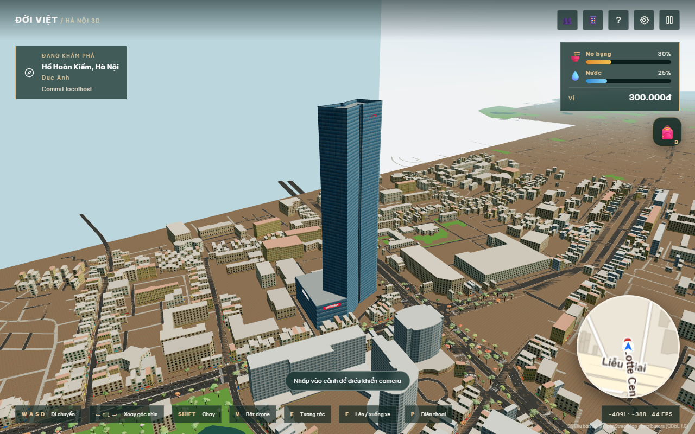
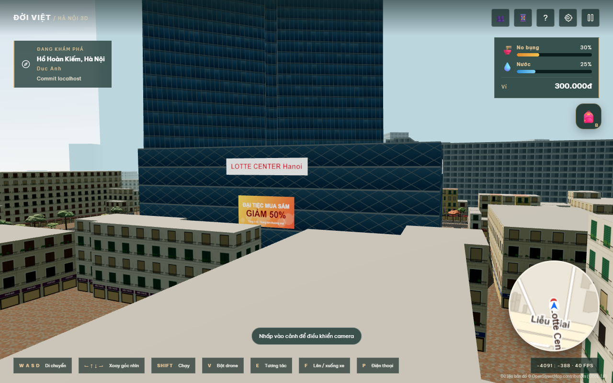

# Vòng 18: Lotte Center Hà Nội, giai đoạn 1 (ngoại thất)

Theo đặc tả 20 mục của chủ dự án ("vừa đọc vừa làm vừa so sánh"). Giai đoạn này chỉ làm phần ngoại thất. Hầm xe, siêu thị B1, trung tâm thương mại, đài quan sát và khách sạn là các giai đoạn sau.

## Dữ liệu dùng (đã kiểm chứng)

- **Mặt bằng và chiều cao:** lấy từ OpenStreetMap (© OpenStreetMap contributors, ODbL), đọc ngày 26/11/2026.
  - Way 727570330 `building:part` (65 tầng, cao 272 m, kính) là thân tháp. Mặt bằng hình nơ: dài ~88 m, rộng 38 m ở hai đầu, chỉ ~24 m ở giữa. Ở giữa, mỗi mặt dài có một khe rộng ~4 m, sâu 2–2,5 m.
  - Way 1195985607 `building:part` (6 tầng, cao 36 m, kính) là khối đế ôm phía nam và phía tây của tháp.
- **Tầng, khai trương, công năng:** theo Wikipedia và đặc tả. 65 tầng nổi, khai trương 02/09/2014.

## Ảnh tham chiếu (chỉ có link, không đưa ảnh của người khác vào repo)

| Ảnh | Góc nhìn | Dùng để đối chiếu |
|---|---|---|
| [znews.vn, 2014](https://photo.znews.vn/w1210/Uploaded/abhuuah/2014_07_31/lotte.jpg) ([bài](https://znews.vn/toa-thap-cao-thu-hai-viet-nam-truoc-dip-khanh-thanh-post441988.html)) | Từ trên cao, phía nam, nhìn lên phía bắc | Dáng hai lá, khe dọc, chữ LOTTE trên lá bên phải, khối đế kính xanh |
| [Thornton Tomasetti](https://www.thorntontomasetti.com/project/lotte-center-hanoi) | Ban đêm | Ô sáng không đều (trang chặn trình duyệt tự động, chưa xem được ảnh) |
| [tektrahomes](https://tektrahomes.vn/thue-toa-building/toa-van-phong-lotte-center-ha-noi-54-lieu-giai) | Khối đế | Kính hoa văn, mái che (chưa tải được ảnh) |

Ảnh ghép so sánh có dùng ảnh znews nên mình chỉ gửi riêng cho chủ dự án, không commit.

## Ảnh trong game

| | Trước (vòng 17) | Sau (vòng 18) |
|---|---|---|
| Từ trên cao |  |  |
| Khối đế |  |  |

Các góc khác sau khi sửa:
- [góc gần giống ảnh znews](lotte-sau-matched.png)
- [mặt dài](lotte-sau-broad.png)
- [đầu hồi phía đông](lotte-sau-end.png)
- [lối vào](lotte-sau-entrance.png)
- [đỉnh tháp](lotte-sau-top.png)
- ban đêm: [từ trên cao](lotte-dem-aerial.png), [mặt dài](lotte-dem-broad.png)

## Đã làm

- **Thân tháp:** dựng đúng mặt bằng OSM.
  - Hai lá nối nhau ở khe giữa; mỗi lá có hai mặt nghiêng nên bắt sáng khác nhau, giống ảnh.
  - Khe mở rộng và sâu dần lên đỉnh. Hai mép khe có gân nhôm dọc.
  - Thân hẹp lại ~4% ở giữa chiều cao rồi mở lại ở đỉnh. Chi tiết eo này là ước lượng từ ảnh.
- **Đỉnh:** mặt kính chạy cao thêm 4 m bao quanh sân thượng, mái ở 268 m, đỉnh ở 272 m.
- **Kính:** xanh #548EB4, sáng #A8CBDC, khung #B8C3C9.
  - Dùng một atlas cho cả mặt: 20 ô × 16 tầng, mỗi ô một sắc hơi khác.
  - Ban đêm có emissive map với ô sáng không đều; không dùng đèn riêng cho từng ô.
- **Chữ:** "LOTTE" màu đỏ #D51D32 trên lá phải của hai mặt dài và trên đầu hồi phía đông. Chỉ là chữ thường, không vẽ lại logo chính thức.
- **Khối đế:**
  - cao 36 m, 6 tầng × 6 m, kính xanh có khung hình thoi;
  - biển chữ "LOTTE CENTER Hanoi", "DEPARTMENT STORE", "LOTTE Mart", "LOTTE HOTEL";
  - một bảng quảng cáo tự vẽ (không dùng nhãn hiệu thật).
- **Lối vào phía đông (đường Liễu Giai):** mái che kính khung thép, 2 bậc đá xám thấp, bồn cây hai bên. Cửa kính lùa tự động và thang máy giữ nguyên như cũ.
- **Va chạm:** sàn mỗi tầng và tường tầng trệt đi theo mặt bằng mới. Đồ nội thất và đèn trần chỉ đặt bên trong mặt bằng.

## Kiểm tra (ghi đúng những gì đã chạy)

- Kiểm tra kiểu (`tsc --noEmit`) và `vite build` chạy sạch trên bản HEAD chỉ cộng 2 file của vòng này.
- Thang máy: vào cabin, chọn tầng 65; cabin lên tới nơi, nhân vật ở độ cao 259,5 m (đúng tầng 65).
  - Chưa thử được đi ra khỏi cabin bằng phím trong trình duyệt tự động.
- **FPS** (Edge headless, 1280×800, cùng máy):

  | Góc | FPS |
  |---|---|
  | Trước khi sửa | 38–42 |
  | Sau khi sửa, ban ngày | 39–44 |
  | Sau khi sửa, ban đêm | 38–46 |

  Có một lần đo bị tụt 8–25 FPS rồi trang tự nạp lại; mình nghĩ do máy, chưa xác định được nguyên nhân. Số tam giác gần như không đổi (~0,93 triệu ở góc từ trên cao).

## Chỗ còn khác ảnh thật (cần chủ dự án duyệt bằng mắt)

1. Trong ảnh znews, khe giữa sâu và tối hơn, và mép ngoài của lá phải cong ra ở đỉnh. Trong game, khe nông hơn và đỉnh hai lá phẳng.
2. Bản đồ game kết thúc ngay phía tây Lotte, nên chưa có hồ Thủ Lệ và Hồ Tây như trong ảnh.
3. Khối đế trong ảnh có dải biển đỏ chạy dài và tầng trệt nhiều cửa kính. Trong game chỉ có 4 biển và 1 bảng quảng cáo.
4. Chưa có xe taxi hoặc NPC đón khách ở sảnh.

Trạng thái duyệt hình: **chờ chủ dự án xem**.

---

# Giai đoạn 2: hầm gửi xe B2–B5, tính phí, thang máy

## Đã làm

- **Tầng và thang máy:**
  - Tầng hầm B1–B5 (mã −1…−5): B1 ở −5 m, mỗi tầng tiếp sâu thêm 3,8 m.
  - `FLOOR_REGISTRY` (floorId, displayName, category, sceneAsset, availableInGame, spawnAnchor) phân tầng theo đặc tả: 65 đài quan sát, 33–64 khách sạn/căn hộ, 32 chưa rõ, 8–31 văn phòng, 7 tiện ích, 1–6 TTTM, B1 LOTTE Mart, B2–B5 gửi xe.
  - Bảng chọn tầng có B5…65. B1 bị khoá (chưa có cảnh) và báo rõ "chưa mở trong game".
  - Thang máy có trạng thái IDLE / OPENING / OPEN / CLOSING / MOVING / ARRIVED và tiếng "ting" khi tới tầng.
  - Không nhận chuyến chồng chuyến: gọi thang khi cabin đang bận thì được xếp hàng.
- **Hầm (cách bố trí do game tự đặt, không phải sơ đồ thật):**
  - Mặt bằng là toàn bộ đường bao OSM của toà nhà.
  - Ô ô tô 2,5 × 5 m; ô xe máy 0,9 × 2 m (B2); có mã ô và khu A–D.
  - Cột 0,8 m chân sơn vàng đen, vạch trắng, mũi tên, gờ giảm tốc, gương cầu lồi.
  - Dải LED trắng; đèn xanh/đỏ trên từng ô (xanh là trống, đỏ là đã có xe).
  - Biển B2…B5, KHU, EXIT, chỉ lên/xuống tầng, P · thang máy.
  - Xe NPC đỗ khoảng một nửa số ô; xe NPC có va chạm.
- **Dốc:**
  - Ba dải dốc rộng 6 m nằm trong tường đông nam của khối đế.
  - Dốc đường ↔ B2 vào qua một cổng ở góc nam khối đế, cạnh đường nội bộ.
  - Phía tây bắc, OSM có một dãy nhà, nên không đặt cổng ở đó được.
  - Dốc có tường hai bên; phía trên hầm có nắp tối, để camera sau xe không nhìn xuyên lên thành phố.
- **Gửi xe** (`src/game/lotteParking.ts`):
  - Đi xe vào cổng thì tự lấy vé (biển số giả lập, giờ vào).
  - Dừng xe trong ô trống và xuống xe thì ô đó được ghi là của người chơi.
  - Lái xe lên dốc thì barie chặn cho tới khi trả phí. Bảng thanh toán hiện biển số, giờ vào, giờ hiện tại, thời gian gửi, hội viên, ô đỗ, phí và số dư ví.
  - Ví thiếu tiền thì báo rõ và không trừ tiền. Trả rồi thì không trừ lần hai.
  - Vé và vị trí xe được lưu: tải lại game, xe vẫn nằm đúng ô.
- **Biểu phí:** đúng như đặc tả, cấu hình trong `parkingConfig`.
  - Xe đạp 3.000đ/lượt.
  - Xe máy 5.000đ/lượt, qua đêm 20.000đ.
  - Ô tô 40.000đ cho mỗi giờ bắt đầu.
  - Hội viên Lime / Green / Orange miễn 120 / 180 / 360 phút mỗi ngày.

## Kiểm tra trong game

Mình chạy bằng script Playwright trên Edge. Ga xe được giữ bằng script vì phím W không vào được trình duyệt headless; phần lái, va chạm và độ cao vẫn là code xe của game.

- Lái ô tô từ ngoài đường vào cổng thì lấy vé. Xe xuống dốc tới B2 ở độ cao −8,48 m, tầng −2.
- Đỗ vào ô B2-A04 thì phiên ghi `parkingSlot = B2-A04` và lưu vị trí xe.
- Lái lên dốc thì xe dừng trước barie và hiện "Trả phí gửi xe: 40.000đ".
- Bấm Thanh toán: ví từ 300.000đ còn 260.000đ, trạng thái `paid`. Lái ra đường thì phiên đóng. Không lấy nhầm vé mới khi đi ra.
- Ví chỉ còn 10.000đ: hiện "Không đủ tiền: cần 40.000đ, ví còn 10.000đ. Chưa trừ tiền", ví giữ nguyên.
- Thử biểu phí:

  | Trường hợp | Phí |
  |---|---|
  | Ô tô 150 phút | 120.000đ |
  | Lime, còn đủ 120 phút miễn | 40.000đ |
  | Lime, đã dùng 100 phút miễn | 120.000đ |
  | Ô tô 60 phút | 40.000đ |
  | Ô tô 61 phút | 80.000đ |
  | Xe máy | 5.000đ |
  | Xe máy qua đêm | 20.000đ |
  | Xe đạp | 3.000đ |

- Đỗ xe máy ở ô B2-A01 rồi tải lại trang: xe máy vẫn ở đúng ô (B2, y = −8,48).
- Thang máy từ tầng 1 xuống B4: tới nơi ở y = −16,08 m, trạng thái OPENING.
- FPS (Edge headless 1280×800, máy này): trong hầm 44–50, trên dốc và ngoài cổng 43–48.
- `tsc --noEmit` và `vite build` sạch trên bản đã commit cộng 4 file của giai đoạn này.

## Ảnh

- [cổng hầm ở góc nam khối đế](ham-cong-vao.png)
- [xe vừa xuống B2](ham-xe-xuong-b2.png)
- [B2: ô đỗ, cột, LED, đèn trạng thái](ham-b2-o-do.png)
- [quầy thu phí và nhân viên](ham-b2-quay-thu-phi.png)
- [bảng thanh toán khi thiếu tiền](ham-thanh-toan-thieu-tien.png)

## Chưa làm hoặc còn hạn chế (nói thật)

- **Thời gian gửi tính theo giờ thật, không theo đồng hồ trong game:** game chưa có đồng hồ lưu bền. Vé có lưu giờ vào nên tải lại không bị mất.
- **Hạng hội viên:** chưa có cách nào để lên hạng trong game, mặc định là Khách thường. Code ưu đãi đã sẵn sàng.
- **Xe máy và xe đạp:** game hiện chỉ có xe máy và ô tô để lái, nên chưa có xe đạp thật để gửi.
- **Xe thuê sau khi tải lại:** sau khi tải lại, xe nằm trong hầm nhưng hợp đồng thuê xe của tiệm thì mất (phần thuê xe vốn không được lưu). Mình cho phép "Lên xe của bạn" để lái ra.
- **Mô hình xe:** xe NPC là khối hộp đơn giản.
- **Camera lái xe:** camera đuổi theo xe (code của Player, mình không sửa) có thể nhô lên trên trần 3,4 m. Khi đó trần trong suốt nhìn từ trên xuống (kiểu cắt lớp), còn nắp tối chặn không cho thấy thành phố.
- **Tầng không có cảnh:** chỉ có B1. Mình chưa làm trường hợp lỗi tải cảnh, vì các tầng dựng bằng React tại chỗ, không tải file.
