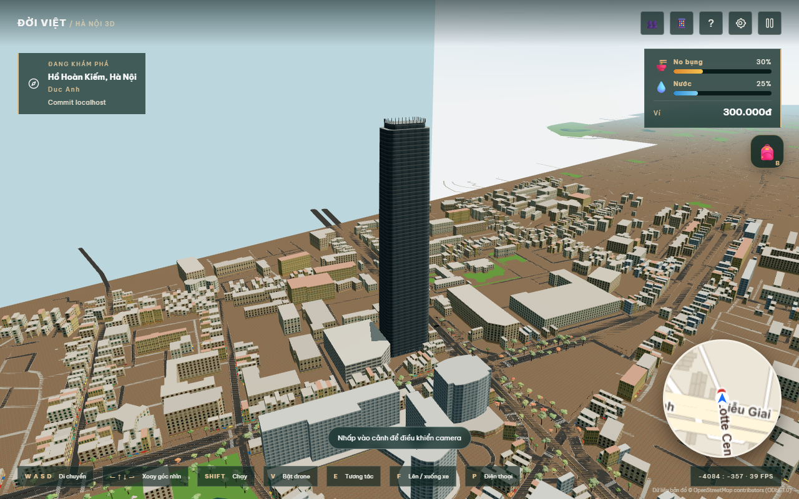

# Vòng 18: Lotte Center Hà Nội, giai đoạn 1 (ngoại thất)

Theo đặc tả 20 mục của chủ dự án ("vừa đọc vừa làm vừa so sánh"). Giai đoạn này chỉ làm phần ngoại thất. Hầm xe, siêu thị B1, trung tâm thương mại, đài quan sát và khách sạn là các giai đoạn sau.

## Dữ liệu dùng (đã kiểm chứng)

- **Mặt bằng và chiều cao:** lấy từ OpenStreetMap (© OpenStreetMap contributors, ODbL), đọc ngày 26/11/2026.
  - Way 727570330 `building:part` (65 tầng, cao 272 m, kính) là thân tháp. Mặt bằng hình nơ: dài ~88 m, rộng 38 m ở hai đầu, chỉ ~24 m ở giữa. Ở giữa, mỗi mặt dài có một khe rộng ~4 m, sâu 2–2,5 m.
  - Way 1195985607 `building:part` (6 tầng, cao 36 m, kính) là khối đế ôm phía nam và phía tây của tháp.
- **Tầng, khai trương, công năng:** theo Wikipedia và đặc tả. 65 tầng nổi, khai trương 02/09/2014.

## Ảnh tham chiếu (chỉ có link, không đưa ảnh của người khác vào repo)

| Ảnh | Góc nhìn | Dùng để đối chiếu |
|---|---|---|
| [znews.vn, 2014](https://photo.znews.vn/w1210/Uploaded/abhuuah/2014_07_31/lotte.jpg) ([bài](https://znews.vn/toa-thap-cao-thu-hai-viet-nam-truoc-dip-khanh-thanh-post441988.html)) | Từ trên cao, phía nam, nhìn lên phía bắc | Dáng hai lá, khe dọc, chữ LOTTE trên lá bên phải, khối đế kính xanh |
| [Thornton Tomasetti](https://www.thorntontomasetti.com/project/lotte-center-hanoi) | Ban đêm | Ô sáng không đều (trang chặn trình duyệt tự động, chưa xem được ảnh) |
| [tektrahomes](https://tektrahomes.vn/thue-toa-building/toa-van-phong-lotte-center-ha-noi-54-lieu-giai) | Khối đế | Kính hoa văn, mái che (chưa tải được ảnh) |

Ảnh ghép so sánh có dùng ảnh znews nên mình chỉ gửi riêng cho chủ dự án, không commit.

## Ảnh trong game

| | Trước (vòng 17) | Sau (vòng 18) |
|---|---|---|
| Từ trên cao |  |  |
| Khối đế |  |  |

Các góc khác sau khi sửa:
- [góc gần giống ảnh znews](lotte-sau-matched.png)
- [mặt dài](lotte-sau-broad.png)
- [đầu hồi phía đông](lotte-sau-end.png)
- [lối vào](lotte-sau-entrance.png)
- [đỉnh tháp](lotte-sau-top.png)
- ban đêm: [từ trên cao](lotte-dem-aerial.png), [mặt dài](lotte-dem-broad.png)

## Đã làm

- **Thân tháp:** dựng đúng mặt bằng OSM.
  - Hai lá nối nhau ở khe giữa; mỗi lá có hai mặt nghiêng nên bắt sáng khác nhau, giống ảnh.
  - Khe mở rộng và sâu dần lên đỉnh. Hai mép khe có gân nhôm dọc.
  - Thân hẹp lại ~4% ở giữa chiều cao rồi mở lại ở đỉnh. Chi tiết eo này là ước lượng từ ảnh.
- **Đỉnh:** mặt kính chạy cao thêm 4 m bao quanh sân thượng, mái ở 268 m, đỉnh ở 272 m.
- **Kính:** xanh #548EB4, sáng #A8CBDC, khung #B8C3C9.
  - Dùng một atlas cho cả mặt: 20 ô × 16 tầng, mỗi ô một sắc hơi khác.
  - Ban đêm có emissive map với ô sáng không đều; không dùng đèn riêng cho từng ô.
- **Chữ:** "LOTTE" màu đỏ #D51D32 trên lá phải của hai mặt dài và trên đầu hồi phía đông. Chỉ là chữ thường, không vẽ lại logo chính thức.
- **Khối đế:**
  - cao 36 m, 6 tầng × 6 m, kính xanh có khung hình thoi;
  - biển chữ "LOTTE CENTER Hanoi", "DEPARTMENT STORE", "LOTTE Mart", "LOTTE HOTEL";
  - một bảng quảng cáo tự vẽ (không dùng nhãn hiệu thật).
- **Lối vào phía đông (đường Liễu Giai):** mái che kính khung thép, 2 bậc đá xám thấp, bồn cây hai bên. Cửa kính lùa tự động và thang máy giữ nguyên như cũ.
- **Va chạm:** sàn mỗi tầng và tường tầng trệt đi theo mặt bằng mới. Đồ nội thất và đèn trần chỉ đặt bên trong mặt bằng.

## Kiểm tra (ghi đúng những gì đã chạy)

- Kiểm tra kiểu (`tsc --noEmit`) và `vite build` chạy sạch trên bản HEAD chỉ cộng 2 file của vòng này.
- Thang máy: vào cabin, chọn tầng 65; cabin lên tới nơi, nhân vật ở độ cao 259,5 m (đúng tầng 65).
  - Chưa thử được đi ra khỏi cabin bằng phím trong trình duyệt tự động.
- **FPS** (Edge headless, 1280×800, cùng máy):

  | Góc | FPS |
  |---|---|
  | Trước khi sửa | 38–42 |
  | Sau khi sửa, ban ngày | 39–44 |
  | Sau khi sửa, ban đêm | 38–46 |

  Có một lần đo bị tụt 8–25 FPS rồi trang tự nạp lại; mình nghĩ do máy, chưa xác định được nguyên nhân. Số tam giác gần như không đổi (~0,93 triệu ở góc từ trên cao).

## Chỗ còn khác ảnh thật (cần chủ dự án duyệt bằng mắt)

1. Trong ảnh znews, khe giữa sâu và tối hơn, và mép ngoài của lá phải cong ra ở đỉnh. Trong game, khe nông hơn và đỉnh hai lá phẳng.
2. Bản đồ game kết thúc ngay phía tây Lotte, nên chưa có hồ Thủ Lệ và Hồ Tây như trong ảnh.
3. Khối đế trong ảnh có dải biển đỏ chạy dài và tầng trệt nhiều cửa kính. Trong game chỉ có 4 biển và 1 bảng quảng cáo.
4. Chưa có xe taxi hoặc NPC đón khách ở sảnh.

Trạng thái duyệt hình: **chờ chủ dự án xem**.
